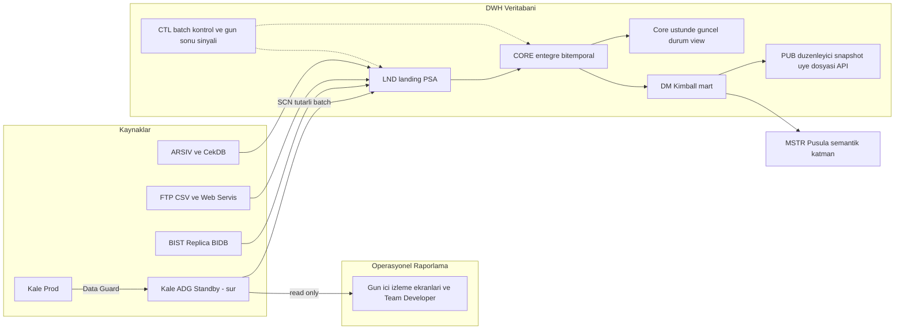

# Başlangıç Yaklaşımı

Takasbank on-prem kurumsal veri ambarı işine nasıl başlanacağının **sahibi** bu nottur: mimari duruş, fazlar, ilk yönlendirme komitesine götürülecek kararlar ve risk kaydı. Açık sorular [[Aktif Sorular]], eylem maddeleri [[Proje Planı]], ortam gerçekleri [[Fiziksel Topoloji - Teknik Taraf]], ODS kapsamı [[Sistemler ve Servisler#4. ODS|ODS]] notlarındadır; burada tekrarlanmaz.

> [!info] Konum
> Bu not [[DWH Hedef Mimarisi v2]] ile aynı ilkeleri (dikey dilim, immutable landing, grain önce, yayın kapısı) paylaşır; ayrıştığı yerler aşağıda "Mimari duruş" bölümünde açıkça işaretlenmiştir. Satıcı tekliflerinden ([[Obase Takasbank Değerlendirme Raporu Ağustos 2024]], [[Komtaş Future-Ready Data Platform Teklifi Ağustos 2026]]) bağımsız yazılmıştır.

## Notların söylediği kurum

Yaklaşımı belirleyen kısıtlar, mevcut notlardan:

- **Perakende banka değil, işlem sonrası piyasa altyapısı.** Kalıcı çapraz-piyasa kavramları taraf/üye, hesap, araç, piyasa × hizmet, takvim ve yükümlülük → talimat → hareket zinciridir: [[Takasbank İş Alanları ve Temel Varlıklar]].
- **Tek monolit kaynak.** Verinin ~%90'ı [[Sistemler ve Servisler#3. Kale|Kale]]'de (~10 TB, ~7.000 ana + ~3.000 backup tablo, ERD yok, şema başına üye tablosu). Uydular: ARSIV (`banka → banka_old → arşiv` yıllık devir), ÇekDB, BIST Replica BIDB (200 tablo / 200 prosedür, gün sonu akışının ~%90'ı Replica → Kale), FTP/CSV, EPİAŞ web servisleri: [[Firmalarla Yapılan DWH Görüşmeleri]].
- **Donanım sorun değil.** Üç Exadata, %77–90 boş disk, `sur` CPU ~%6–12, `hisar` ~%2–3; Kale'nin iki Data Guard replikası var, biri `sur` üstünde: [[DWH Sunum Aralık 2024]], [[Fiziksel Topoloji - Teknik Taraf]].
- **Kısıt insan.** İZV ekibi 1 yönetici + 2 MSTR geliştirici; güçlü Oracle DBA / PL/SQL; DWH/ETL deneyimi yok; tablo bilgisi UG analistlerinde; DBA ekibi GoldenGate'e güvenmiyor ve 7/24 ekibi yok. Satın alma yavaş; veri kurum dışına çıkamaz.
- **Operasyonel raporlama baskın.** Team Developer, React ekranları, MSTR Pusula (%10–20 taşındı), üye terminal raporları, saat SLA'lı SPK/MASAK/BDDK/Hazine çıktıları. "İzleme" ekranlarının çoğu Kale üstünde gün içi güncel-durum sorgusudur: [[Takasbank Genel Bilgilendirme 2]], [[Banka Ug]].
- **Makine-okunur gün sonu yok.** Tamamlanma mail ile; notlarda iki çelişen gün sonu zaman çizelgesi; tarihsel satırlar güncellenebiliyor; Borsa sözleşme verisi 5 gün sonra siliniyor: [[Ortamlar hakkında]], [[DWH Sunum Temmuz 2025]].

## Mimari duruş

Numaralı maddelerde **v2'den veya satıcı önerilerinden ayrışan** noktalar `↔` ile işaretlidir.

1. **Yalnızca Oracle / Exadata.** Cloudera, Spark, Kafka yok. 10 TB ve Oracle ekibiyle ikinci platform saf kadro maliyetidir. [[ETL Tool Evaluation]] çalışma kitabı kalır; Cloudera/Spark orada yalnızca neden kaybettiklerini belgelemek için durur.
2. **Gün içi operasyonel raporlama, Active Data Guard read-only standby'dan verilir; GoldenGate'ten ve yeni bir "ODS" veritabanından değil.** `↔` Kale'nin `sur` replikası zaten var. Read-only açılıp (ADG lisansı ve açılış modu DBA ile doğrulanacak: [[Aktif Sorular]]) izleme ekranları ve Team Developer sorguları buraya yönlendirildiğinde en hızlı ve en düşük riskli Kale boşaltması elde edilir: yeni araç yok, modelleme yok, DBA'ler zaten işletiyor. `tvsods` emekli edilir; kararın kaydı [[Sistemler ve Servisler#4. ODS|ODS]] notundadır.
3. **Başlangıçta ayrı fiziksel ODS yok.** `↔` Entegre güncel-durum, core üstünde projeksiyondur (view/MV) ve yalnızca ölçülmüş SLA gerektiren konuda açılır. Ham güncel-durum standby'dır. Obase'nin "önce ODS" ve v2'nin "ODS = projeksiyon" konumları tek test edilebilir kurala indirgenir.
4. **DWH veritabanının yerleşimi bir testtir, slayt değil.** `↔` Önceki sunumlar DWH'ı PREPROD, DSS, TRUVA ve on başka DB'nin yanına `sur`'a koydu. `hisar` neredeyse boşta ve ARSIVDB'yi barındırıyor; tarihçeyi orada toplamak cazip. Karar, DBA ekibiyle IO/CPU izolasyon testinden sonra verilir.
5. **Gecikme sınıfına göre alma; önce batch.** S2 gün sonu, standby'dan SCN-tutarlı çıkarım (`AS OF SCN`, tablolar arası tutarlı). S1 mikro-batch yalnızca değişiklik kolonu güvenilir kanıtlanan tablolarda. S0 CDC yalnızca bir veri ürünü SLA'yı kanıtladığında ve GoldenGate lisans iddiası (Obase "var" diyor, DBA "yeni" diyor) doğrulandığında. Prod Kale'ye hiçbir yol dokunmaz: trigger, MV log, dblink yok. Sınıf tanımları: [[DWH Hedef Mimarisi v2#Veri alma ve gecikme sınıfları]].
6. **Dönüşüm = DWH içinde SQL / PL/SQL pushdown.** Pilot, satın alma gerektirmeyen araçla başlar (PL/SQL çerçevesi veya dbt-core + dbt-oracle; Git, otomatik test). ODI / Informatica değerlendirmesi paralel yürür ve ürün kararı **Pilot B çıkış kapısında** ölçülmüş kanıtla verilir; pilot satın almaya bekletilmez. Karar kaydı şablonu: [[ETL Selection Decision Record]].
7. **Model = iteratif entegre core + Kimball mart; Data Vault yok.** Conformed taraf/üye, hesap, araç, piyasa × hizmet, takvim ve `settlement_rule` (versiyonlu; T+2 → T+1 2026 sonunda geliyor). Bitemporal kolonlar yalnızca tarihsel güncellemenin kanıtlandığı varlıklarda. MSTR semantik katmanı yalnızca mart'lara oturur. Entity ayrıntısı: [[DWH Logical Data Model]].
8. **Arşiv bir DWH sorumluluğu olur.** `↔` Yıllık `banka_old` devri ve 3.000 backup tablosu elle yapılmış partitioning'dir. Tarihçe DWH'da yaşadığında Kale kayan pencere tutar; uzun vadeli depolama/IO rahatlaması asıl buradan gelir ve programın yazılı hedefi olmalıdır.
9. **Güvenlik birinci gün tasarlanır.** PowerDesigner hassasiyet bayrakları sınıflandırmayı tohumlar; prod DWH maskesiz ama VPD / Data Redaction + TDE + audit ile korunur; non-prod mevcut Informatica TDM ile maskelenir. SPK kullanıcılarının DB_ARSIV'deki view'lara dblink üzerinden erişmesi pratiği, denetlenen ve sürümlü değişmez düzenleyici snapshot'lar taşıyan `PUB` şemasıyla değiştirilir.

## Fazlar

Faz içi görev listeleri [[Proje Planı]] notundadır; burada yalnızca her fazın amacı ve çıkış kapısı tutulur.

### Faz 0 — İlk 30 gün: gerçekler, mandat ve iki ucuz kazanım

- **Mandat ve yönetişim (1. hafta):** isimli sponsor, yönlendirme kadansı, konu alanı başına "hangi sayı doğru" karar hakkı ([[DWH Ownership Operating Model]] bugün var olan rollere indirgenerek). Programın birincil KPI'ı: raporlamaya atfedilen, ölçülmüş Kale DB-time azalması ve gün sonu süresi.
- **Görüşme değil ölçüm (1–4. hafta):** 4 haftalık AWR/ASH yük çalışması; log tabanlı rapor envanteri; standby üstünde kaynak profilleme; mimariyi değiştiren üç iddianın doğrulanması (ADG modu, GoldenGate lisansı, UG gün sonu prosedürlerinin standby'da koşup koşamayacağı).
- **İki ucuz kazanım:** gün sonu tamamlanma olayı (iş tarihi, koşu kimliği, SCN taşıyan batch-control kaydı) ve BIST fon sözleşme verisinin **hemen** landing'e alınması (kaynakta 5 gün sonra siliniyor; modelleme beklemez).
- **Ekip (2–4. hafta):** 1 veri modelleyici, 2 Oracle-güçlü veri mühendisi, dilim başına dönüşümlü UG analisti, DBA irtibat. Danışmanlık: pilotta birlikte inşa eden sınırlı ortak; üç aylık kâğıt tasarım çalışması değil (Komtaş teklifi kapsamıyla bir RFP teslim eder, bir ambar değil).

> [!failure] Faz 0 çıkış kapısı
> Yönlendirmeli rapor envanteri (standby / DWH / uygulamada kalır), puanlanmış pilot listesi, doğrulanmış lisans gerçekleri, çalışan gün sonu sinyali, kapasite ve yerleşim testi sonuçları.

### Faz 1 — Pilot A ile platform temeli: SWIFT yasal raporlar

**Neden ilk:** tek kaynak şema; T-1 kabul edilebilir; 2 milyar satır / 170 GB ve serbest metinde kimlik arama görünür bir Kale kazanımı; net düzenleyici tüketici; güvenlik tasarımını zorlar (serbest alanda TCKN). Conformed üye/piyasa boyutu gerektirmediği için modelleme tartışmasına girmeden tesisatı kanıtlar: [[DWH Sunum Temmuz 2025#Slayt 11 — SWIFT yasal raporlar]].

Kapsam: `CTL`/`LND` standardı, standby'dan SCN-tutarlı çıkarım, ayrı yükleme kimliğiyle replay/backfill, gün sonu olayına asılan Automic zinciri; mesaj varlığı + çıkarılmış kimlik tablosu; düzenleyici talebi başına içerik hash'li, değişmez "as delivered" `PUB` snapshot'ı; VPD/redaction rolleri ve her okuma/dışa aktarımın audit'i; aynı kesimde mevcut Kale sorgusuyla mutabakat; kırmızıda kapanan yayın kapısı.

> [!failure] Faz 1 çıkış kapısı
> Ölçülmüş Kale DB-time azalması, sahibi ekibin paralel koşum onayı, operasyona teslim edilmiş runbook.

### Faz 2 — Pilot B ile entegrasyon kanıtı: BISTECH SPK 13 rapor

**Neden ikinci:** iki kaynak (Kale'de NOMX + Replica BIDB), gün sonu sinyaline bağımlı, conformed taraf/üye, araç ve piyasa × hizmet'i zorlar, dblink tabanlı düzenleyici erişimini `PUB` deseniyle değiştirir. Pilot A'nın çalıştırmadığı her şeyi çalıştırır: [[DWH Sunum Temmuz 2025#Slayt 22 — BISTECH SPK raporları: kaynaklar]].

Kapsam: ilk gerçek `CORE` paketi (party/party_xref, membership, account, instrument, market_service, business_calendar, versiyonlu settlement_rule); UG gün sonu özet prosedürlerinin DWH dönüşümü olarak yeniden yazılması ve paralel koşum sonrası Kale kopyalarının emekli edilmesi; ilk `DM` yıldızı üstünde MSTR semantik katmanı; metrik tanımlarının rapor değil iş sahibi tarafından sahiplenilmesi.

> [!failure] Faz 2 çıkış kapısı ve araç kararı
> İki pilotun kanıtıyla ETL seçimi kapatılır (PL/SQL veya dbt-core / ODI / Informatica), mevcut puan kartı kullanılarak: [[ETL Tool Evaluation]].

### Faz 3 — Operasyonel rapor göçü ölçekte

Envanterin tamamına uygulanan yönlendirme kuralı:

- **Ham Kale yapıları üstünde gün içi güncel-durum** → standby; bağlantı yönlendirilir, modelleme yok. Team Developer ve izleme ekranlarının büyük kısmı.
- **Gün sonundan türetilen özet / operasyonel raporlar** (Kale'ye özet tablo yazan UG prosedürleri) → DWH'da hesaplanır, React/MSTR'a view veya API ile geri sunulur. Gün sonunu kısaltır, Kale'den yazma yükünü kaldırır.
- **Tarihsel, analitik, çapraz piyasa, düzenleyici** → mart + MSTR.
- Team Developer kullanım sırasına göre emekli edilir; kullanılmayan raporlar yeniden yazılmaz.

### Faz 4 ve sonrası — Konu alanı yayılımı

Kale yüküne ve conformed core'un tekrar kullanımına göre, envanterle doğrulanarak: fon platformları (gün içi düzeltmeli Fon Bilgilendirme ve 10 yıllık CSV/web servis tarihçesi; Verda'ya fon işlem defterleri), sonra risk/teminat/MKT (bankanın ortak çekirdeği), ödeme ve hareketler, saklama/kurumsal aksiyon, enerji/emtia, çek/kredi/escrow, ücretler. Her dilim aynı keşif kapısından, paralel koşumdan ve yayın kapısından geçer. Kale'den arşiv boşaltması, tarihçe DWH'a geçtikçe sürekli iş akışı olur. Sıralama ayrıntısı [[Proje Planı#Faz 4 — Kurumsal yayılım]].

## İlk yönlendirme komitesine götürülecek kararlar

1. Tek platform Oracle / Exadata; büyük veri yığını yok.
2. Gün içi operasyonel raporlama read-only standby'a; `tvsods` kapatılır.
3. Ölçülmüş SLA gerektirene kadar ayrı fiziksel ODS yok.
4. DWH yerleşimi (`sur` / `hisar`) emsalle değil izolasyon testiyle.
5. Pilot A = SWIFT yasal raporlar, Pilot B = BISTECH SPK; fon sözleşme yakalaması şimdi başlar.
6. Satın almasız araçla başlanır; ETL ürün kararı Pilot B çıkışında kanıtla.
7. Modelleyici ve iki mühendis alınır; dilim başına UG analist zamanı güvenceye alınır.
8. Gün sonu tamamlanma sinyali ilk ay içinde operasyonla kurulur.

## Risk kaydı (ilk gün)

- **GoldenGate işletme yükü** bir S0 gereksinimi çıkarsa — önce ADG; GG yalnızca ürün bazında ve DBA 7/24 kapsamı anlaşıldıktan sonra.
- **BES kişisel veri yoğunluğu** (Kale'nin ~%80'i iddiası) — landing öncesi sınıflandırma, tokenize katılımcı anahtarı.
- **T+1 geçişi** 2026 sonunda takas kurallarını program ortasında değiştirir — Pilot B'den itibaren versiyonlu `settlement_rule`.
- **Tarihsel yerinde güncellemeler** artımlı yükleri kırar — önce profil; bitemporal yalnızca kanıtlanan yerde, aksi hâlde SCN snapshot.
- **Yetkinlik açığı ve tek ekipte bilgi birikimi** (Vakıfbank dersi: [[DWH Sunum Aralık 2024#Slayt 4 — Vakıfbank]]) — UG analistleri modelleri birlikte sahiplenir, Git tabanlı kod, operasyona teslim edilmiş runbook.
- **Satıcı biçimli tasarım** (önce ODS, 100 konu alanlı kavramsal model, yalnızca RFP çıktısı) — kararı slayt değil pilot kanıtı verir.

İlgili notlar: [[DWH Hedef Mimarisi v2]] · [[Proje Planı]] · [[Aktif Sorular]] · [[Fiziksel Topoloji - Teknik Taraf]] · [[Sistemler ve Servisler]] · [[DWH Logical Data Model]] · [[ETL Tool Evaluation]] · [[DWH Ownership Operating Model]]
