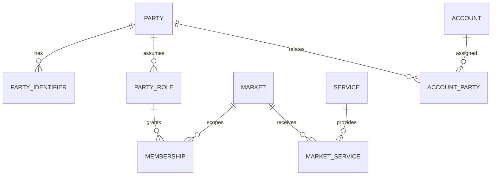

# DWH Mimari Tasarım

Takasbank [[Sistemler ve Servisler#1. DWH|DWH]] için katman mimarisi, modelleme yaklaşımı ve yükleme desenleri. Bu not **tasarım kararlarının** sahibidir; ortam/donanım gerçekleri [[Fiziksel Topoloji - Teknik Taraf]], açık sorular [[Aktif Sorular]], faz planı [[Proje Planı]] notlarında.

> [!warning] Taslak
> Aşağıdaki kararlar iş birimleriyle (UG + operasyonel ekipler) doğrulanmadı. Rapor yerleşimi analizi yapılmadan kesinleşmez: [[Aktif Sorular]].

## Karar: hibrit yaklaşım

[[Inmon vs Kimball]] sorusuna cevap: **ikisi birlikte**. Normalize bir entegrasyon katmanı + üzerine Kimball star mart'ları.

Gerekçe: [[Sistemler ve Servisler#3. Kale|Kale]]'de aynı kavramın (mesela `üye`) birden fazla şemada farklı tabloları var. Doğrudan mart üretmek bu tutarsızlığı mart'lara kopyalar. Entegrasyon katmanı `üye`yi bir kez çözer, mart'lar oradan beslenir.
doğrudan inmon yaklaşımını benimsemek de çok vakit kaybettirir. çok fazla farklı business var.

Teslimat yine parça parça: her fazda **bir konu alanı** dikey olarak baştan sona (kaynak → mart → MSTR) tamamlanır. Topyekün entegrasyon beklenmez; entegrasyon katmanı konu alanı geldikçe büyür.
Hangi ekiplerle sürece başlanacağını belirlemek çok kritik.
İlk başta party gibi yapıları modelleyebileceğimiz, çekirdek diyebileceğimiz ekiplerle görüşüp onların datalarını modelleyerek başlamak lazım.


## Katmanlar

| Kod | Şema | İçerik | Tarihçe | Erişim |
|---|---|---|---|---|
| L0 | `LND_<kaynak>` | Kaynak şeklinde ham veri, dönüşüm yok | **Tam tarihçe, append-only (PSA)** | Sadece ETL |
| L1 | `ODS_*` | Entegre, güncel değerli, temizlenmiş | Güncel değerli | Operasyonel sorgu + rapor |
| L2 | `EDW` | Entegre, normalize, kurumsal tanım | Tam tarihçe (SCD2) | Sadece ETL + analist |
| L3 | `DM_<konu>` | Star schema: fact + dimension | Fact'te olay tarihçesi | MSTR, raporlar |
| L4 | — | MSTR semantik katmanı, metrik tanımları | — | Son kullanıcı |

- **L0 kaynak başına ayrı şema:** `LND_KALE`, `LND_BIST`, `LND_CEK`, `LND_FILE`…  L0'da dönüşüm mantığı **yasak**.
- **L0 neden tam tarihçe:** Geçmiş dataya update gelebiliyor ([[Aktif Sorular]]); mart'ı sıfırdan yeniden üretebilmek için kaynağın o an ne dediğini saklamak gerekiyor. Aynı zamanda denetim izi. Exadata'da HCC bu maliyeti taşır.
- **L0 → L1 sınırı:** L0 kaynak şeklindedir, L1 entegredir. Bu sınır korunmazsa operasyonel kullanıcılar ham kaynak tablolarını sorgulamaya başlar ve `üye` problemi çözülmek yerine aşağıya taşınır. Kapsam kararı: [[Sistemler ve Servisler#4. ODS|ODS]]
- **L1 rapor verir:** "Güncel veri lazım, tarihçe lazım değil" sınıfı raporların cevabı L1.
- **L2 tek gerçek:** Bir kavramın tanımı burada bir kez yaşar. Mart'lar L2'yi okur, birbirini okumaz.
- **L3 mart sınırı:** Bir mart bir konu alanı + bir grain. İki UG'nin farklı `üye` tanımını aynı mart'ta karıştırmak yasak.
- **L4 metrik:** Hesaplanmış iş metrikleri (komisyon oranı, net yükümlülük) MSTR'da değil, mümkün olduğunca L3'te maddileşir. MSTR sadece sunar.

## Kaynak başına giriş yolu

Kaynak listesi ve ODS kapsam kararı: [[Sistemler ve Servisler#4. ODS|ODS]]. Araç seçenekleri (GoldenGate / ODI) ve rol ayrımı: [[Sistemler ve Servisler#2. Goldengate|Goldengate]].

| Kaynak                                   | Yol                                           | Not                                                                                          |
| ---------------------------------------- | --------------------------------------------- | -------------------------------------------------------------------------------------------- |
| [[Sistemler ve Servisler#3. Kale\|Kale]] | `sur` üstündeki replikadan okuma → `LND_KALE` | ETL prod Kale'ye hiç dokunmaz                                                                |
| Arşiv, ÇekDB                             | Oracle replikasyon veya batch extract         | Tazeleme ihtiyacı henüz belirsiz                                                             |
| BIST DB                                  | Zamanlanmış çekim, conformed dış besleme      | Başka kurumun ambarı: grain'i ve penceresi devralınır, real-time yok                         |
| CSV / FTP                                | External table veya `SQL*Loader` → `LND_FILE` | Aşağıdaki dosya sözleşmesi                                                                   |
| Postgre / MSSQL                          | GoldenGate                                    | Dataguard bu kaynakları **hiç** alamaz: [[Sistemler ve Servisler#2. Goldengate\|Goldengate]] |


### Sahiplik

Fark raporu sadece ETL ekibine gitmez, ilgili UG'ye de gider. Sahibi olmayan fark kapanmaz; kapanmayan fark birikince mutabakat gürültüye dönüşür ve kimse bakmaz.

## Oracle / Exadata tarafı

DWH `sur` Exadata üzerinde ([[Fiziksel Topoloji - Teknik Taraf]]).

- Fact tabloları `takas_tarih_sk` üzerinden **RANGE partition** (aylık veya günlük).
- Geçmiş partition'larda **HCC** (`COLUMN STORE COMPRESS FOR QUERY HIGH`); aktif partition sıkıştırmasız.
- **L0 arşiv partition'ları HCC `ARCHIVE HIGH`** — tam tarihçeli landing'in maliyetini taşıyan şey bu; sadece yeniden üretimde okunur.
- **Kapasite:** L0 tam tarihçe + çok kaynak, ODS'i kaledb'nin ~10 TB'ından hızla büyütür. 1 Exadata ≈ 200 TB olduğu için yer var, ama yerleşim kararı bunu gerektiriyor: [[Sistemler ve Servisler#4. ODS|ODS]].
- Fact FK'larında **bitmap index**, `star_transformation_enabled` açık.
- Dimension PK'ları enforced; fact FK'ları `RELY DISABLE NOVALIDATE` (optimizer bilsin, yük yavaşlamasın).
- MSTR'ın sık çektiği toplamlar için **materialized view + query rewrite**.


## Güvenlik

Hassas veri ve veri sahibi bilgisi [[Sistemler ve Servisler#5. PowerDesigner|PowerDesigner]]'dan gelir. Alınacak her kolon bu katalogla eşleştirilir.

Sınır **L0'dır, DWH değil**: çok kaynaklı landing'le hassas veri artık en dışta iniyor, dolayısıyla eşleme dosya/tablo landing'e inmeden önce yapılmalı. Gerekçe: [[Sistemler ve Servisler#4. ODS|ODS]]. Maskeli verinin alınıp alınmayacağı hâlâ açık: [[Aktif Sorular]] madde 6.


# DWH Hedef Mimarisi v2

Takasbank [[Sistemler ve Servisler#1. DWH|DWH]] için kurumsal hedef veri mimarisi. İş alanları ve kalıcı iş kavramları [[Takasbank İş Alanları ve Temel Varlıklar]], entity ve ilişkiler [[DWH Logical Data Model]], ortam gerçekleri [[Fiziksel Topoloji - Teknik Taraf]], veri alma aracı [[Sistemler ve Servisler#2. Goldengate|Goldengate]], uygulama sırası [[Proje Planı]], cevap bekleyen kararlar [[Aktif Sorular]] notlarındadır.

> [!warning] Önerilen hedef
> Bu tasarım, resmî kamu kaynakları ve mevcut toplantı notlarından türetilmiştir. İç kaynak-grain-SLA envanteri henüz tamamlanmadığı için fiziksel tablo tasarımları konu alanı analizi sırasında doğrulanmalıdır.

## Yönetici özeti

Önerilen yaklaşım: **iteratif kurumsal core + Kimball veri ürünleri**.

- Kaynak verisi, ods'de tutulacak. ods, dwh ile aynı veritabanında tutulacak. her kaynak sistem için ayrı şemalar oluşturulacak.
- anlık rapor ve operasyonel rapor talepleri ods'den sağlanacak.
- MSTR, yasal rapor, analitik raporlar dwh üzerinden verilecek.
- 

Bu model; bir yandan birden fazla kaynakta bulunan `üye` ve hesap kimliklerini birleştirir, diğer yandan bütün kurumu modellemeyi beklemeden seçilen bir iş sonucunu uçtan uca teslim eder.

## v1 incelemesi

Korunan doğru kararlar:

- dikey dilimlerle teslimat,
- kaynak başına dönüşümsüz landing,
- replay ve idempotency,


- prod [[Sistemler ve Servisler#3. Kale|Kale]]'yi doğrudan sorgulamama,

- gün sonunu sabit saat yerine tamamlanma olayına bağlama.

Değiştirilen veya sınırlandırılan kararlar:

1. **`T+2` sabit değildir.** Takas kuralı piyasa, ürün ve geçerlilik dönemine göre versiyonlanır.
2. **PowerDesigner sahiplik ve erd bilgisi tutar
3. **Kaynak sistem otomatik olarak otorite değildir.** İşlem için BISTECH, kıymet bakiyesi için MKK/TCMB, nakit için TCMB/muhabir, resmî bildirim için kabul edilmiş gönderim farklı otoriteler olabilir.
4. **Accumulating snapshot tek denetim izi değildir.** Değişmez olay fact'i saklanır; süreç görünümü bunun üzerinden üretilir.
5. **Mutabakat toleransı tek tip değildir.** Aynı grain ve para ölçeğinde beklenen kesin eşitlik ayrı; fiyatlama, değerleme ve zamanlama farkı versiyonlu iş kuralı ayrıdır.
6. **200 TB donanım kapasite onayı değildir.** Kullanılabilir alan, büyüme, indeks, geçici alan, replika, yedek ve saklama süresi birlikte hesaplanır.
7. **ODS ile EDW aynı entegrasyonu iki kere yapmaz.** 
8. **`üye`, tek başına kurumsal ana boyut değildir.** Taraf, rol ve üyelik ayrılır.
9. **Tek piyasa takas martı kesin pilot değildir.** İçeride önerilen üye-dosya projesiyle birlikte karar kapısında değerlendirilir.

## Mimari ilkeler

### Grain önce gelir

Her tablo ve veri ürünü şu cümleyi tamamlamadan oluşturulmaz:

> Bu tablodaki bir satır, ... başına bir ... temsil eder.

İşlem, MKT bacağı, netleştirme grubu, yükümlülük, talimat ve hareket ayrı grain'lerdir. Aynı satıra sıkıştırılmaz.


### İş zamanı ile sistem zamanı ayrıdır

- **İş geçerlilik zamanı:** Bilginin iş dünyasında ne zaman doğru olduğu.
- **Sistem zamanı:** DWH'ın bilgiyi ne zaman gördüğü ve hangi sürümle sakladığı.

Bu ayrım, “31 Ağustos'ta ne geçerliydi?” ve “5 Eylül'de 31 Ağustos için ne biliyorduk?” sorularını ayrı cevaplar.


### DWH operasyonel defterin yerine geçmez

DWH; denetlenebilir analitik, raporlama, veri ürünü ve yeniden üretim platformudur. Canlı takas, ödeme veya teminat defterinin işlem sistemi değildir.

### Gizlilik en dış sınırda başlar

Hassasiyet sınıfı landing'den yayına kadar taşınır. Üretim doğruluğunu bozacak kör maskeleme yerine amaç bazlı erişim, şifreleme ve tokenization kullanılır; non-prod kopyalar maskelenir. Kesin politika [[Aktif Sorular]]'da onaylanmalıdır.


## Katman sözleşmeleri


### `LND_<kaynak>` — immutable landing / PSA

Amaç: Kaynağın teslim ettiği veriyi dönüştürmeden kanıtlamak ve tekrar oynatmak.

Zorunlu teknik metadata:

```text
kaynak_sistem
kaynak_nesne
kaynak_pk
kaynak_islem_tipi
kaynak_islem_ts
kaynak_checkpoint
alinma_ts
yukleme_id
kayit_hash
sozlesme_surumu
dosya_mesaj_id
```

Kurallar:

- İş kuralı ve kimlik birleştirme yapılmaz.
- Tekrar teslim edilen kayıt atılmaz; duplicate durumu işaretlenir.
- Dosya checksum/manifest ve mesaj kimliği korunur.
- Şema kayması karantinaya veya geriye uyumlu sözleşmeye yönlendirilir.
- Immutable, “sonsuz süre çevrimiçi tut” anlamına gelmez. Saklama sınıfı; mevzuat, replay penceresi, hacim ve hassasiyete göre belirlenir.
- Silme/anonymization talebi yasal saklama ve denetim iziyle birlikte ele alınır.

### `STG_*` — geçici standardizasyon

Kalıcı kurumsal katman değildir. Veri tipi düzeltme, kod normalizasyonu, teknik deduplication ve set-based yük hazırlığı için kullanılır. Yük sonunda temizlenebilir; tekrar üretimin kaynağı landing'dir.

### `CORE_*` — bitemporal kurumsal core

Kurum çapında anlamın ve tarihçenin sahibidir.

Model stili:

- açık isimli taraf, üyelik, hesap, piyasa, hizmet ve araç tabloları,
- değişmez işlem ve süreç olayları,
- geçerlilik tarihli ilişki ve referans kuralları,
- kaynak kimliklerini kurumsal anahtara bağlayan xref tabloları,
- hem iş hem sistem zamanı taşıyan historized master kayıtları.

Tam Data Vault hub-link-satellite yapısı zorunlu değildir. Mevcut Oracle/PL/SQL yetkinliği için açık iş varlıklı ilişkisel model daha okunabilir; raw audit ihtiyacını landing ve bitemporal kolonlar karşılar. Data Vault ancak model otomasyonu, test ve ekip yetkinliği ayrıca sağlanırsa yeniden değerlendirilir.

Örnek zaman kolonları:

```text
valid_from_ts
valid_to_ts
system_from_ts
system_to_ts
is_current
record_source
yukleme_id
```

`valid_to_ts` açık uçlu aralıkla yönetilir. Geriye dönük düzeltme, eski sistem sürümünü kapatır ve doğru iş-zamanı aralığına yeni sistem sürümü ekler.

### `ODS_*` — current-state projection

Amaç: “Şimdi geçerli durum nedir?” sorgularına düşük gecikme ve basit erişim sağlamak.

- Core'un `is_current`/geçerlilik mantığından üretilir.
- Yalnızca gerçek operasyonel rapor veya entegrasyon SLA'sı olan konu alanlarında açılır.
- Tam tarihçenin sahibi değildir.
- Core'dan farklı taraf/üye çözümleme kuralı içermez.
- Materialized view, hızlı yenilenen tablo veya servis görünümü olabilir; fiziksel yöntem SLA testiyle seçilir.
- ODS raporu kaynak işlem sisteminin yazma işlevini devralmaz.

Mevcut `tvsods` kopyasının hedef ODS ile aynı şey olmadığına ilişkin karar [[Sistemler ve Servisler#4. ODS|ODS]] notundadır.

### `DM_<konu>` — dimensional marts

MSTR ve analitik tüketim için yıldız şemalardır.

- Her fact'in grain'i, additive davranışı ve geç gelen veri politikası yazılır.
- Dimension'lar core anahtarından türetilir.
- Fact, başka bir fact veya marttan iş ana verisi üretmez.
- SCD tipi alan bazında belirlenir; her dimension'a otomatik SCD2 uygulanmaz.
- Unknown, not-applicable ve withheld üyeleri ayrı surrogate key alır.
- Degenerate işlem/talimat kimliği gerektiğinde fact üzerinde korunur.

### `PUB_*` — yayın ve veri ürünleri

Tek tüketim biçimi MSTR değildir:

- MSTR semantik modeli ve sertifikalı metrikler,
- düzenleyici rapor snapshot'ları,
- üye dosyaları,
- kontrollü API/extract,
- veri bilimi ve AI için amaçla sınırlandırılmış feature/view'lar.

Yayınlanan her ürünün sahibi, SLA'sı, veri sözleşmesi, lineage'ı, kalite durumu ve aktif sürümü bulunur. Tüketici fiziksel `DM_` tablosuna değil veri ürünü sözleşmesine bağlanır.

## Kurumsal kimlik modeli



## Metadata, lineage ve veri sözleşmesi

PowerDesigner mevcut kaynak kolon kataloğu ve sahibiyet için kullanılır. Eksik işlevler ayrı metadata süreçleriyle tamamlanır:

- kolon seviyesinde source-to-target lineage,
- veri elemanı otorite matrisi,
- veri ürünü ve metrik tanımı,
- şema/kural sürümü,
- çalıştırma lineage'ı,
- kalite ve mutabakat sonucu,
- kullanım ve etki analizi.

Bir kaynak değişikliği için:

1. sözleşme farkı tespit edilir,
2. etkilenen core/mart/rapor bulunur,
3. geriye uyumluluk sınıflanır,
4. test ve onay tamamlanır,
5. yeni sürüm kontrollü yayınlanır.

## Fiziksel topolojiye eşleme

Makine, veritabanı, replika ve ortam gerçeklerinin tek sahibi [[Fiziksel Topoloji - Teknik Taraf]] notudur. Bu bölüm yalnızca o gerçeklerden türetilen hedef kararları taşır.

Hedef eşleme:

- Prod Kale doğrudan ETL kaynağı olmaz.
- Kale verisi, topoloji notundaki DWH tarafı replikadan uygun okuma garantisi sağlandıktan sonra landing'e alınır.
- Replika lag'i ve snapshot/SCN, her yükün kontrol kaydıdır.
- Landing, core ve marts DWH kaynak grubunda; ETL, MSTR ve ad-hoc sorgular birbirinden izole edilir.
- Hedef ODS'in fiziksel makinesi kapasite, HA, gecikme ve workload testinden sonra seçilir; mevcut kale yerleşimi hedef kabul edilmez.
- PREPROD/DSS, prod DWH mimarisinin kalıcı besleme kaynağı sayılmaz.

### Kapasite modeli

Karar öncesi ölçülecekler:

- günlük insert/update/delete ve değişim oranı,
- initial history hacmi,
- raw/core/mart çoğaltma katsayısı,
- indeks ve materialized view alanı,
- aktif/cold partition oranı,
- temp/undo ve yükleme çalışma alanı,
- backup, standby ve kurtarma alanı,
- online ve archive saklama süreleri,
- yıllık büyüme ve güvenlik payı.

“Exadata yaklaşık 200 TB, kaledb yaklaşık 10 TB” bilgisi bu ölçümlerin yerine geçmez.

### Oracle/Exadata uygulama ilkeleri

- Büyük fact'ler en sık kullanılan iş tarihi ve retention sınırına göre range partition edilir.
- Alt partition ancak piyasa/servis dağılımı ve pruning testi fayda gösterirse eklenir.
- Aktif partition yük desenine uygun; değişmez cold partition HCC için adaydır.
- `ARCHIVE HIGH`, yalnızca seyrek okunan ve replay SLA'sını bozmayan landing arşivinde değerlendirilir.
- Local B-tree varsayılandır; bitmap indeks yalnızca düşük eşzamanlı DML ve ölçülmüş analitik faydada kullanılır.
- Partition exchange ve paralel DML bulk/backfill için; mikro-batch için otomatik varsayım değildir.
- Constraint'ler doğruluğu korur. `RELY DISABLE NOVALIDATE` ancak kanıtlanmış ETL kontrolü ve optimizer testiyle istisna olabilir.
- Materialized view, sadece gerçek sorgu profili ve refresh penceresiyle gerekçelendirilir.
- SQL plan, partition pruning, istatistik ve veri skew'i performans testinin parçasıdır.

## Dayanıklılık ve işletim

Her veri ürünü için:

- RPO ve RTO,
- maksimum kabul edilebilir bayatlık,
- yeniden oynatma başlangıç noktası,
- backup/restore testi,
- DR ortamı ve failover prosedürü,
- yükleme ve yayın rollback yöntemi,
- operasyon sahibi ve escalation

tanımlanır.

Gözlem metrikleri:

- kaynak ve ürün freshness,
- replika lag'i,
- throughput ve backlog,
- kalite/mutabakat başarısı,
- açık karantina kaydı,
- yayın sürümü ve yaşı,
- sorgu süresi/kaynak tüketimi,
- teslimat ve düzenleyici gönderim başarısı.

## Teslimat yaklaşımı

Kurumsal model topyekûn tamamlanmayı beklemez. Her dikey dilim:

1. iş çıktısı ve sahibi,
2. grain ve otorite,
3. kaynak sözleşmesi,
4. landing,
5. gerekli core varlıkları,
6. ODS gerekiyorsa current projection,
7. mart/veri ürünü,
8. mutabakat ve güvenlik,
9. MSTR/dosya/rapor yayını,
10. operasyon ve SLA

ile biter.

Pilot ve fazların sahibi [[Proje Planı]] notudur.

## Mimari kabul kriterleri

Bir veri ürünü üretime hazır sayılmazsa:

- grain ve doğal anahtar onaylı değilse,
- veri-elemanı otoritesi belli değilse,
- iş zamanı ve sistem zamanı ayrılmamışsa,
- source-to-report lineage eksikse,
- replay aynı sürümle aynı sonucu üretmiyorsa,
- kalite ve iş mutabakatı yeşil değilse,
- hassasiyet/erişim/saklama kuralı yoksa,
- RPO/RTO ve operasyon sahibi belirlenmemişse,
- MSTR veya dış teslimat metrikleri sertifikalı değilse

yayın kapısı açılmaz.

## Açık kararlar

Bu tasarımın uygulanmasını bloke eden veya fiziksel seçimi değiştiren konular [[Aktif Sorular]] notundadır. Özellikle:

- hizmet-piyasa-kaynak envanteri,
- atomik işlem ve netleştirme lineage'ının kaynakta bulunup bulunmadığı,
- konu alanı bazında otorite,
- latency/SLA sınıfları,
- güvenilir gün sonu sinyali,
- ODS fiziksel yerleşimi,
- prod/non-prod maskeleme,
- RPO/RTO ve saklama,
- pilot kapsamı

onaylanmadan ilgili fiziksel karar kesinleştirilmez.

İlgili notlar: [[Sistemler ve Servisler#1. DWH|DWH]] · [[DWH Logical Data Model]] · [[DWH Mimari Tasarım]] · [[Takasbank İş Alanları ve Temel Varlıklar]] · [[Sistemler ve Servisler#4. ODS|ODS]] · [[Proje Planı]] · [[Aktif Sorular]]
