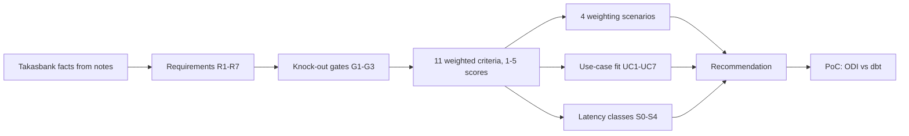
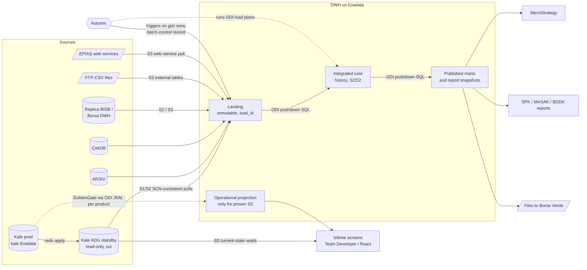

# ETL Araç Karşılaştırması - Ekim 2026

Independent comparison of five candidate ETL/ELT technologies for the Takasbank on-prem enterprise DWH, which also has to serve operational and near-real-time reporting. Vendor facts were checked on **14 October 2026**.

- Workbook with live scoring formulas: [Takasbank-ETL-Comparison.xlsx](../../outputs/etl-comparison-2026-10/Takasbank-ETL-Comparison.xlsx)
- The numbers come from one file, `outputs/etl-comparison-2026-10/comparison_data.py`. Change a score or a weight there, then rebuild the workbook with `python3 build_workbook.py --json`.
- The [interactive canvas](https://cursor.com/canvas/store-c51f9d48-85cf-4b41-b001-38182c25e2b0/f3289cee-ea17-4bbb-b867-d518bff85354) lets you re-weight the criteria live. Its source is `outputs/etl-comparison-2026-10/Takasbank-ETL-Comparison.canvas.tsx`.

## 1. Executive summary and recommendation

> [!success] Recommendation
> Use **Oracle Data Integrator 14c** as the enterprise ELT platform, with all transformation pushed down into Exadata.
> - Serve S0 near-real-time **izleme** screens from the Kale **Active Data Guard read-only standby** on `sur`. Do not use an ETL tool for them.
> - Add **GoldenGate** (through the ODI journalizing KM) only for data products whose S0 SLA has been proven and signed off, and only with agreed DBA on-call cover.
> - Keep **dbt-core + dbt-oracle** as the qualified alternative. It is also the procurement-free fallback if the ODI purchase stalls. The PoC runs ODI and dbt head to head on the same pilots.
> - **Exclude PowerCenter**, because it fails the support-horizon gate. Do **not** build the core DWH on **Cloudera** or **Spark**.

| | ODI | PowerCenter | dbt | CDP | Spark |
|---|---:|---:|---:|---:|---:|
| Knock-out gates | Pass | **Fail (G2)** | Conditional | Pass | Conditional |
| Weighted score, base weights (of 100) | **77.6** | 60.6 | 69.8 | 59.6 | 47.0 |
| Rank | 1 | 3 | 2 | 4 | 5 |
| Average use-case fit (1–5) | **4.00** | 3.29 | 2.86 | 3.71 | 2.86 |
| 5-year TCO band | Medium | High | Low | Very high | High |

Why ODI wins:

1. **The compute is already paid for.** Kale holds about 90% of the data (about 10 TB). The three Exadata machines have 77–90% of their disk free and low CPU on `sur` and `hisar`. An ELT tool that generates set-based SQL inside Exadata (ODI or dbt) uses that capacity. CDP and Spark would add a second compute and storage platform and copy regulated data out of Exadata and back.
2. **The team is Oracle and PL/SQL.** ODI and dbt both let the existing DBA and PL/SQL people work in SQL. CDP and Spark need Hadoop, Kafka, Flink and Python/Scala engineers, plus 24/7 operations that Takasbank does not have.
3. **ODI covers ingestion. dbt does not.** Takasbank's workloads include FTP/CSV files, EPİAŞ web services, Borsa DWH contract pulls (the source keeps only 5 days) and outbound files to Verda. ODI handles these natively. With dbt, an ingestion and landing framework would have to be built and owned in-house.
4. **Most real-time demand does not need an ETL tool.** S0 izleme screens are current-state reads, and a read-only ADG standby serves them without touching prod Kale. That removes the main argument for a streaming platform.

Sensitivity: ODI leads in three of the four weighting scenarios. dbt overtakes it only when 5-year TCO is weighted at 22% (cost-first: dbt 76.2 vs ODI 75.4). This is why dbt stays in the PoC as the real alternative and is not treated as a token one.

## 2. Takasbank context and requirements

These are facts taken from [[Fiziksel Topoloji - Teknik Taraf]], [[Sistemler ve Servisler]], [[Takasbank İş Alanları ve Temel Varlıklar]], the meeting notes and [[Firmalarla Yapılan DWH Görüşmeleri]]. The architecture positions in those notes are deliberately not adopted here.

| Area | What matters for ETL selection |
|---|---|
| Institution | Post-trade market infrastructure: clearing, CCP, settlement, custody and payments. Regulated by SPK, BDDK and TCMB. **Data cannot leave the bank.** |
| Core source | **Kale**, on the `kale` Exadata: about 90% of all data, about 10 TB, about 7,000 main and 3,000 backup tables, no ERD. Member tables are duplicated per schema. |
| Other sources | ARSIV (`banka → banka_old → arsiv` yearly rollover), ÇekDB (cheque images stored as CLOB), BIST Replica BIDB / Borsa DWH, FTP/CSV, EPİAŞ web services, possibly Postgres or MSSQL. |
| Hardware | Three Exadata machines (`kale`, `sur`, `hisar`), about 200 TB each with 77–90% of disk free. CPU on `sur` is about 6–12% and on `hisar` about 2–3%. |
| Replicas | Kale has Data Guard replicas, one of them on `sur`. DSS and PREPROD are detached from Kale at 07:00. |
| Reporting | Team Developer screens, a React web front end, MicroStrategy (only 10–20% migrated so far), member terminal reports, and SPK/MASAK/BDDK/Hazine reports with hour-level SLAs. |
| Real-time demand | The **izleme** screens are near-real-time current-state views. Fon Bilgilendirme recalculates between 08:00 and 17:45. Piyasalar UG reports performance problems on prod. |
| Gün sonu | Triggered manually; completion is announced by e-mail. Preprod flashback snapshots run 04:00–07:00. **There is no machine-readable completion signal.** |
| Team | IZV has one manager and two MSTR developers. Oracle DBA and PL/SQL skills are strong, but there is no DWH or ETL experience. Table knowledge sits with the UG analysts. |
| Operations | No 24/7 monitoring team. The DBAs consider GoldenGate fragile. Several teams already use Automic as their scheduler. |
| Licences | The only known Informatica licence is TDM (masking). GoldenGate and ADG licence status is disputed; see [[Aktif Sorular]] item 14. |
| Procurement | Slow. Any product that needs a new purchase order delays the pilot. |

Requirements derived from these facts:

- **R1 On-prem only.** No cloud control plane, and no agent that must call out to the internet.
- **R2 Push down into Exadata.** The 2-billion-row SWIFT history and the 20M takas positions per day should be processed where the data lives.
- **R3 Latency by class.** S0 to S4 (section 6) are designed separately, and the tool is not allowed to dictate them.
- **R4 Usable by the current team.** An Oracle DBA or PL/SQL developer must be productive quickly.
- **R5 No new 24/7 burden.** The scheduler is Automic, and restart and replay must be possible without manual data fixes.
- **R6 Auditable.** Regulatory reports need lineage from source column to report and a full run history.
- **R7 Long support horizon.** A DWH built from 2026 needs vendor fixes until at least late 2031.

## 3. Method

The five tools are **not like-for-like**:

- ODI and PowerCenter are integration suites.
- dbt only transforms data that is already inside the database.
- Cloudera is a full data platform.
- Spark is a processing engine.

To compare them fairly, each one is scored **as the deployable stack Takasbank would actually run**, including whatever it needs for CDC and orchestration.

- **Knock-out gates** are checked before any scoring:
  - G1: runs fully on-prem;
  - G2: vendor security fixes for 5 years or more;
  - G3: production-grade support for Oracle 19c/23ai on Exadata.
- **Scoring:** 11 criteria with weights that sum to 100. Each tool gets a 1–5 score per criterion with a written rationale; the rationales are in the `Scoring Matrix` sheet of the workbook.
  - Weighted total = Σ(weight × score) / 5, so the maximum is 100.
- **Sensitivity:** three alternative weightings (Oracle-team-first, real-time-first and cost-first) test whether the ranking holds.
- **Use-case fit:** seven real Takasbank workloads, each scored 1–5 separately from the criteria.

## 4. Tool profiles

### 4.1 Oracle Data Integrator 14c (14.1.2)

- **Stack:** ODI 14c agents with Knowledge Modules. GoldenGate is added through the journalizing KM only for proven S0/S1 feeds. Automic calls ODI scenarios and load plans.
- **Lifecycle:** Fusion Middleware 14.1.2 has Premier Support until Dec 2030 and Extended Support until Dec 2033. ODI 12c Premier Support ends in Dec 2026, so new projects should start on 14c.
- **Licensing:** per processor or Named User Plus on **every host that runs an ODI agent**. The list reference is about USD 30k per processor plus 22% annual support. A clustered agent HA setup also needs WebLogic EE and Coherence EE. GoldenGate is licensed separately, and a GoldenGate licence includes ADG and XStream entitlements.
- **Strengths:**
  - E-LT by design: the generated SQL runs inside Exadata and uses Smart Scan, HCC, parallel DML and partition exchange.
  - Ready-made KMs for SCD2, incremental merge, CDC and bulk loading (external tables, SQL*Loader, DB link from the standby).
  - Repository-based column lineage and impact analysis.
  - Load plans can restart from the point of failure.
  - Already used in the local capital-markets ecosystem (Borsa İstanbul), and local partners exist.
- **Weaknesses:**
  - GUI-centric development. Git integration exists, but branching and merging repository objects is awkward.
  - Real-time capability depends on GoldenGate, which the DBA team distrusts.
  - Custom KMs now need Python 3 (Jython is deprecated).
- **Takasbank fit:** the best structural fit for an Oracle-only estate where Exadata is already paid for and the team writes PL/SQL.

### 4.2 Informatica PowerCenter 10.5.x

- **Stack:** PowerCenter Integration Service and Repository, PowerExchange CDC for Oracle (separate licence) and the Pushdown Optimization option.
- **Lifecycle:** **standard support ended on 31 Mar 2026.** Paid Extended Support runs to 31 Mar 2027. Sustaining Support runs to 31 Mar 2029 but brings no new fixes or security patches. Salesforce completed its acquisition of Informatica on 18 Nov 2025.
- **Successor:** CDI-PC (PowerCenter on IDMC) is billed by IPU consumption. It runs through a Secure Agent that is managed from Informatica's cloud control plane, and updates are cloud-managed and mandatory.
- **Strengths:**
  - The broadest connector catalogue of the five.
  - Mature workflow management and restart.
  - Metadata Manager lineage.
  - PowerCenter developers are available in Türkiye.
  - Takasbank already has an Informatica relationship through TDM.
- **Weaknesses:**
  - Buying it in 2026 for a DWH meant to last ten years means buying a forced migration.
  - The successor conflicts with R1, because its control plane is in the cloud.
  - The default engine processes rows outside the database.
  - Git and CI support is weak.
- **Takasbank fit:** **fails gate G2.** It would only make sense as a bridge for an existing PowerCenter estate, and Takasbank has none.

### 4.3 dbt (dbt-core 1.12 + dbt-oracle 1.12)

- **Stack:** dbt-core with the dbt-oracle adapter on Linux runner VMs. Ingestion is done by PL/SQL plus external tables or SQL*Loader (or by ODI). Automic runs `dbt build`, and the code lives in Git with CI.
- **Lifecycle and licence:**
  - Apache 2.0, no licence fee.
  - Each minor release gets about one year of support.
  - The adapter is maintained by Oracle.
  - **dbt v2 / Fusion has no Oracle adapter**, so Takasbank would stay on dbt-core 1.x.
  - The Fivetran and dbt Labs merger completed on 1 Jun 2026. The dbt platform (SaaS) is excluded under R1.
- **Strengths:**
  - Pure SQL pushdown on Exadata, the same compute advantage as ODI.
  - Code-first: Git, pull-request review, automated data tests, environments and a docs site.
  - Snapshots for SCD2, plus incremental and microbatch strategies.
  - No purchase order needed, so a pilot can start immediately.
- **Weaknesses:**
  - Transformation only. There is no extraction, file handling, web-service ingestion or CDC.
  - dbt-core gives model-level lineage only.
  - No vendor SLA for self-hosted Core.
  - Jinja, YAML and the Git workflow are new to a PL/SQL team.
- **Takasbank fit:** a strong transformation layer and the fastest start, but it needs a home-built ingestion and orchestration layer around it.

### 4.4 Cloudera Data Platform: Base on premises 7.3.2 LTS

- **Stack:**
  - Cloudera Base: Ozone/HDFS, Iceberg, Hive/Impala, Spark.
  - Cloudera Streaming: Kafka, Flink, and Kafka Connect with Debezium.
  - Flow Management: NiFi.
  - SDX governance: Atlas and Ranger.
- **Lifecycle:** 7.3.2 LTS became generally available in Mar 2026 and is supported until Mar 2032.
- **Licensing:** a subscription measured in Cloudera Compute Units (cores ÷ 6 + RAM GB ÷ 12) plus data under management. It runs on its own commodity-server cluster and **cannot run on Exadata**.
- **Strengths:**
  - The strongest native streaming stack of the five.
  - NiFi handles files and web services well.
  - Atlas and Ranger provide fully on-prem governance.
- **Weaknesses:**
  - It would be a second platform next to three largely empty Exadata machines.
  - Data has to leave Exadata to be processed and come back for MSTR, which means double copies and two security perimeters.
  - The required skills are absent, and it needs a platform team plus 24/7 operations.
  - Oracle CDC still needs a log reader on the Kale side.
- **Takasbank fit:** oversized for a 10 TB Oracle-centric DWH. Worth revisiting only if a future streaming, AI or unstructured-data mandate comes with funding and a team.

### 4.5 Apache Spark 4.2 (self-managed)

- **Stack:** Spark 4.2 (SQL, Structured Streaming, Declarative Pipelines) with Kafka, Debezium and Airflow or Automic. Results go to Iceberg or are written back to Oracle over JDBC. Security and lineage are self-built, for example with OpenLineage.
- **Lifecycle:** a feature release roughly every 6–7 months (4.0 in May 2025, 4.1 in Dec 2025, 4.2 in Jul 2026). Real-time Mode arrived in 4.1 and CDC APIs in 4.2. Support comes from the community or third parties.
- **Strengths:**
  - The most flexible engine: Python, Scala and SQL, ML and streaming.
  - No licence cost.
  - Git-native and testable.
- **Weaknesses:**
  - Everything around the engine is DIY: scheduling, security, lineage, monitoring and upgrades.
  - Data leaves Exadata through JDBC, which is the worst path for the SWIFT history.
  - It needs a team Takasbank does not have.
- **Takasbank fit:** the weakest fit of the five: the highest engineering load and the least use of the existing Oracle investment.

## 5. Criteria matrix

### 5.1 Knock-out gates

| Gate | ODI | PowerCenter | dbt | CDP | Spark |
|---|---|---|---|---|---|
| **G1** Fully on-prem, no external control plane | Pass | Conditional: 10.5 yes, but the only supported successor needs a cloud control plane | Pass: dbt-core only | Pass | Pass |
| **G2** Vendor security fixes to late 2031 or later | Pass: to Dec 2030 / Dec 2033 | **Fail**: standard support ended Mar 2026, no new fixes after Mar 2027 | Conditional: OSS with no SLA, each minor line supported 1 year | Pass: to Mar 2032 | Conditional: community only |
| **G3** Oracle 19c/23ai on Exadata | Pass | Pass | Pass | Pass (JDBC) | Pass (JDBC) |
| **Overall** | **Pass** | **Fail** | **Conditional** | **Pass** | **Conditional** |

The "Conditional" results for dbt and Spark are acceptable only if the support risk is covered, either by a third-party support contract or by internal runbooks with clear ownership.

### 5.2 Weighted scores (1 = poor, 5 = excellent)

| Criterion | Weight | ODI | PowerCenter | dbt | CDP | Spark |
|---|---:|---:|---:|---:|---:|---:|
| Exadata / Oracle pushdown and performance | 14 | 5 | 3 | 5 | 2 | 2 |
| Real-time, CDC and operational reporting | 12 | 3 | 3 | 2 | 4 | 4 |
| Security, on-prem and regulatory compliance | 10 | 4 | 2 | 4 | 4 | 2 |
| Governance: lineage, metadata, audit, data quality | 10 | 4 | 4 | 3 | 4 | 2 |
| Team skill fit and learning curve | 10 | 4 | 3 | 4 | 1 | 1 |
| Source connectivity | 8 | 4 | 5 | 1 | 5 | 3 |
| Transformation and modelling | 8 | 4 | 4 | 4 | 3 | 3 |
| 5-year total cost of ownership (higher = cheaper) | 8 | 3 | 2 | 5 | 1 | 2 |
| Operations and orchestration | 7 | 4 | 4 | 3 | 2 | 1 |
| DevOps: Git, CI/CD, automated tests | 6 | 3 | 2 | 5 | 3 | 4 |
| Vendor viability, roadmap and local support | 7 | 4 | 1 | 2 | 4 | 2 |
| **Weighted total (of 100)** | **100** | **77.6** | **60.6** | **69.8** | **59.6** | **47.0** |
| **Rank** | | **1** | 3 | 2 | 4 | 5 |

Key score rationales (the workbook has every cell):

- **Pushdown:** ODI and dbt get 5 because both compile to SQL that runs in Exadata. CDP and Spark get 2 because they read and write Oracle over JDBC.
- **Real-time:** CDP and Spark get 4 because they stream natively but still need an Oracle log reader. ODI gets 3 because S0 comes only through GoldenGate. dbt gets 2 because S1 microbatch is its limit.
- **Security:** PowerCenter gets 2 because security fixes stop after Mar 2027 and its successor needs an internet-connected agent. Spark gets 2 because all security is self-built.
- **Connectivity:** dbt gets 1 because it ingests nothing.
- **Vendor:** PowerCenter gets 1 because it is at end of support, has changed ownership, and the partner reports no new on-prem sales.

### 5.3 Sensitivity

| Criterion | Base | Oracle-team-first | Real-time-first | Cost-first |
|---|---:|---:|---:|---:|
| Pushdown | 14 | 16 | 10 | 12 |
| Real-time | 12 | 8 | **24** | 8 |
| Security | 10 | 10 | 10 | 10 |
| Governance | 10 | 8 | 8 | 8 |
| Skills | 10 | **16** | 8 | 10 |
| Connectivity | 8 | 6 | 10 | 6 |
| Transform | 8 | 8 | 6 | 8 |
| TCO | 8 | 8 | 6 | **22** |
| Operations | 7 | 8 | 8 | 6 |
| DevOps | 6 | 6 | 4 | 5 |
| Vendor | 7 | 6 | 6 | 5 |

| Scenario | ODI | PowerCenter | dbt | CDP | Spark | Leader |
|---|---:|---:|---:|---:|---:|---|
| Base (Takasbank profile) | **77.6** | 60.6 | 69.8 | 59.6 | 47.0 | ODI |
| Oracle-team-first | **78.8** | 60.0 | 73.6 | 54.4 | 43.6 | ODI |
| Real-time-first | **75.2** | 62.0 | 62.8 | 64.4 | 51.2 | ODI |
| Cost-first | 75.4 | 57.4 | **76.2** | 52.2 | 44.8 | dbt |

How to read the scenarios:

- Doubling the real-time weight still does not let CDP overtake ODI, because CDP loses on pushdown, skills, TCO and operations.
- dbt wins only when cost dominates the decision.
- PowerCenter's total does not matter, because it is already excluded by gate G2.

## 6. Real-time and operational reporting (S0–S4)

The latency class is chosen **per data product**, before any tool is chosen (see [[Aktif Sorular]] item 3). Each tool's support for each class is scored 1–5:

| Class | Typical Takasbank workload | ODI | PowerCenter | dbt | CDP | Spark | Recommended pattern |
|---|---|---:|---:|---:|---:|---:|---|
| **S0** near real-time (seconds) | Izleme screens, Team Developer current-state queries | 2 | 3 | 1 | 5 | 4 | Kale ADG read-only standby on `sur`. GoldenGate into an operational projection only for products with a proven SLA. |
| **S1** intraday micro-batch (5–30 min) | Fon Bilgilendirme 08:00–17:45 with correction files | 4 | 4 | 3 | 5 | 4 | Watermark- or SCN-based micro-batch from the standby into landing; recompute only the affected funds. |
| **S2** gün sonu (T-1) | 13 BISTECH SPK reports, SWIFT legal reports, takas positions | 5 | 4 | 5 | 3 | 3 | SCN-consistent extract from the standby, triggered by a machine-readable gün sonu event. |
| **S3** file / external feed | FTP/CSV, EPİAŞ web services, Borsa DWH contracts, Verda output files | 4 | 5 | 1 | 5 | 3 | Landing with a manifest and checksum; external tables for files; web-service pulls into landing. |
| **S4** backfill / replay | 10-year fund history, SWIFT history since 2013, ARSIV yearly rollovers | 5 | 3 | 5 | 4 | 4 | Replay from immutable landing under a new `load_id`; partition exchange for bulk history. |

> [!important] Real-time conclusion
> CDP and Spark score highest only on S0. On S0, an **ADG standby** handles most of the demand (current-state reads) with no ETL tool at all, and **GoldenGate via ODI** covers the rest. Buying a streaming platform for S0 would mean running a second platform for the smallest slice of the workload.
>
> This conclusion depends on two facts that are still unconfirmed: whether ADG is licensed and opened read-only, and what the apply lag is. Both are tracked in [[Aktif Sorular]] item 14.1 and [[Fiziksel Topoloji - Teknik Taraf#Kale replikası - doğrulanacak gerçekler]].

## 7. Use-case fit

Each tool's fit for each workload is scored 1–5:

| Use case | Profile | ODI | PowerCenter | dbt | CDP | Spark |
|---|---|---:|---:|---:|---:|---:|
| UC1 SWIFT legal reports | 2B rows / 170 GB since 2013, about 1M messages/day; collapse to about 24M rows (one per message); free-text ID search; T-1 | 5 | 3 | 5 | 3 | 3 |
| UC2 Fon Bilgilendirme | About 60k notifications/day; recalculation 08:00–17:45 with corrections; 10-year history via CSV and web service | 4 | 3 | 3 | 4 | 3 |
| UC3 Fon işlem defterleri | 9M Borsa DWH contracts/day (deleted at source after 5 days), cleansed to about 600k; files to Verda twice a day per market | 4 | 4 | 2 | 4 | 3 |
| UC4 BISTECH SPK 13 reports | Kale NOMX + Replica BIDB after Takas UG gün sonu; replace the DB_ARSIV dblink views | 5 | 4 | 4 | 2 | 2 |
| UC5 EPİAŞ settlement feeds | Web-service files, 5–10k records/day, collateral data | 3 | 4 | 1 | 5 | 2 |
| UC6 Operational izleme screens (S0) | Intraday current-state queries that today hit prod Kale | 2 | 2 | 1 | 4 | 3 |
| UC7 Takas positions and history | About 20M positions/day; yearly rollover into DWH partitions | 5 | 3 | 4 | 4 | 4 |
| **Average** | | **4.00** | 3.29 | 2.86 | 3.71 | 2.86 |

dbt's low scores on UC3 and UC5 come from ingestion, not from transformation; the SQL side would score as high as ODI. UC6 is mostly an ADG question, not an ETL question (section 6).

Workload sources: [[Takasbank Genel Bilgilendirme 2]], [[Takas UG]], [[Enerji UG]], [[Banka Ug]], [[DWH Sunum Temmuz 2025]].

## 8. Five-year TCO drivers

These are **cost bands, not quotes**. Real figures need vendor quotes, and the Oracle numbers depend on the agent topology.

| Driver | ODI | PowerCenter | dbt | CDP | Spark |
|---|---|---|---|---|---|
| Software licence (5 years) | Medium–High: about USD 30k per processor on agent hosts (x86 core factor 0.5) + 22%/yr support | High: quote-based, extended-support premium, IPU billing after migration | None | High: CCU + data-under-management subscription | None |
| CDC / real-time add-on | GoldenGate per processor, only for S0 products | PowerExchange CDC licence | External (ADG / GoldenGate) | Included in Cloudera Streaming; still needs an Oracle log reader | Kafka + Debezium (free), operated in-house |
| Infrastructure | Low: 2 agent VMs, compute on Exadata | Medium: integration servers + repository database | Low: runner VMs, compute on Exadata | High: new multi-node cluster | High: new Kubernetes/YARN cluster + Kafka |
| People (build + run) | 2 data engineers + part-time ODI admin | 2 ETL developers + Informatica admin | 2–3 data engineers (including the ingestion framework) + DevOps | 3–4 platform engineers + 2 data engineers, 24/7 on-call | 3–5 platform/data engineers, 24/7 on-call |
| Training / hiring risk | Low–Medium | Medium | Low–Medium | High | High |
| Exit / migration cost | Medium (logic in KMs, SQL visible) | High (forced re-platform before 2029) | Low (plain SQL in Git) | High | Medium |
| **Overall band** | **Medium** | **High** | **Low** | **Very high** | **High** |

ODI's licence cost is offset by needing no new compute and by a smaller people bill than dbt, which needs its own ingestion framework, or CDP and Spark, which need platform teams.

## 9. Risks and mitigations

| Tool | Risk | Likelihood | Impact | Mitigation |
|---|---|---|---|---|
| ODI | GoldenGate operational burden if S0 products are approved | Medium | High | Serve raw izleme from the ADG standby first. Add GoldenGate per product only with agreed DBA on-call, and monitor lag in the control tables. |
| ODI | Licence scope creep (agents on more hosts; HA needs WebLogic EE) | Medium | Medium | Fix the agent topology before the purchase order. Use standalone agents with Automic-level failover instead of a WebLogic cluster. |
| ODI | GUI development hides logic from code review | Medium | Medium | ODI VCS on Git, naming standards, scenario versioning, and review of the generated SQL in pull requests. |
| PowerCenter | End of life forces a second migration | High | High | Do not select it. |
| PowerCenter | Cloud control plane conflicts with data-residency rules | High | High | Legal and compliance review before any further evaluation. |
| dbt | The home-built ingestion framework becomes an unsupported product | Medium | High | Keep landing minimal (external tables, PL/SQL pulls from the standby), documented and owned, or pair dbt with ODI for ingestion. |
| dbt | The Oracle adapter lags dbt v2 / Fusion | High | Medium | Pin dbt-core 1.x and dbt-oracle; avoid features that exist only in the SaaS platform. |
| dbt | No vendor SLA for production incidents | Medium | Medium | A third-party support contract or internal runbooks. The failure surface is small because the SQL runs in Oracle. |
| CDP | A second platform without a platform team | High | High | Do not adopt it for the core DWH. |
| CDP | Two copies of regulated data and two security perimeters | High | Medium | Avoided by keeping the DWH on Exadata. |
| Spark | DIY platform with no vendor support | High | High | Not recommended. If ever used, buy commercial support and limit it to non-critical analytics. |
| Spark | JDBC bottleneck for large Oracle loads | High | Medium | Keep heavy SQL inside Exadata. |
| All | No machine-readable gün sonu completion signal | High | High | Operations produces a batch-control record (business date, run id, SCN) before any S2 pipeline goes live; see [[Aktif Sorular]] item 12. |
| All | Historical rows updated in place break incremental loads | Medium | High | Profile change columns on the standby. Where there is no reliable timestamp, fall back to SCN snapshots and hash-diff; see [[Aktif Sorular]] item 7. |

## 10. Proof-of-concept plan: ODI vs dbt

Both finalists build the **same** pilot slices on the **same** Exadata DEV/TEST environment, reading from the standby. ODI runs on a trial or evaluation licence; dbt needs no purchase. Each test is passed or failed against an acceptance criterion agreed in advance, and the results are recorded in the `PoC Plan` sheet of the workbook.

| ID | Test | Use case | What is measured | Acceptance |
|---|---|---|---|---|
| T1 | SWIFT bulk + delta | UC1 | Initial load of the 2B-row history and the daily delta into the summary table: elapsed time, Exadata CPU/IO, Smart Scan offload ratio | The daily delta finishes inside the T-1 window, and results match the current Kale query for a sample of IDs |
| T2 | Intraday Fon recompute | UC2 | Micro-batch from the standby every 15 min, with a correction file mid-day | End-to-end freshness of 15 min or better; the corrected fund is recomputed; reruns are idempotent |
| T3 | Borsa contract capture + Verda files | UC3 | Land 9M contracts/day raw, cleanse, and produce per-market files twice a day with a manifest and hash | No lost day (the source keeps 5 days); files byte-identical to the current output on a test day |
| T4 | SPK report reconciliation | UC4 | Build 3 of the 13 SPK reports from NOMX + Replica BIDB after the gün sonu event | 100% reconciliation with the current Kale tables for the same business date |
| T5 | Replay and backfill | UC7 | Replay a failed day from landing under a new `load_id`; backfill one year of positions | Same result as the original run, with no manual data fixes |
| T6 | Restart after failure | All | Kill a run mid-load | Restarts from the failed step without duplicates; operator steps are in a runbook |
| T7 | Lineage | UC4 | Trace one SPK report column back to its source columns | Column-level lineage available without manual spreadsheets |
| T8 | Automic + gün sonu event | All | Trigger the S2 chain from the batch-control record, not from a clock | The chain starts on the event, and failures alert Automic and the owner |
| T9 | Security | All | Secrets handling, least-privilege accounts, TDE/VPD/redaction respected, audit of reads and exports | Security team sign-off; no data or metadata leaves the bank |
| T10 | Promotion and CI | All | Promote a change DEV → TEST → PREPROD with automated tests | Repeatable, reviewed deployment with rollback |

Decision rule:

- ODI is confirmed if it passes T1–T10 with no Fail.
- dbt replaces it only if it passes the same tests and the cost of building its ingestion layer (T3, plus UC5 file and web-service feeds) is lower than the ODI licence over 5 years.
- Pilot selection and ownership stay in [[Proje Planı]].

## 11. Recommended target integration pattern

Principles:

1. **One engine, SQL inside Exadata.** ODI generates set-based SQL, and no data leaves Exadata to be transformed.
2. **Never read prod Kale for batch work.** S1 and S2 read from the standby at a recorded SCN.
3. **Landing is immutable and replayable.** Every run has a `load_id`, so replay and backfill (S4) never need manual fixes.
4. **The event, not the clock, starts S2.** Automic waits for the gün sonu batch-control record.
5. **Real-time is the exception.** ADG serves S0 reads first. GoldenGate is added per data product only after its SLA is proven and DBA on-call is agreed.
6. **The dbt fallback has the same shape.** If dbt wins the PoC, it replaces only the landing-to-core and core-to-published arrows. Landing is then done with PL/SQL and external tables (or ODI), and nothing else in the diagram changes.

## 12. Open questions

These questions are tracked in [[Aktif Sorular]] and are not restated here. The ones that can change this recommendation:

- Item 3 and 3.1: the latency class per data product. This decides whether GoldenGate is needed at all.
- Item 12: the gün sonu completion signal. It is a prerequisite for every S2 pipeline, whichever tool wins.
- Item 14.1 and 14.2: ADG and GoldenGate licence status. This changes both the S0 pattern and the ODI + GoldenGate cost band.
- Item 14.4: whether the DWH goes on `hisar` or `sur`. This determines where the ODI agents and landing run.
- Item 15: source access for the pilots (SWIFT search logic, Replica BIDB read permission, Borsa contract landing).

## 13. Sources

Vendor facts were checked on 2026-10-14.

- [Oracle FMW Statement of Direction (14.1.2 support to 2030/2033)](https://blogs.oracle.com/fusionmiddlewaresupport/oracle-fusion-middleware-statement-of-direction-is-now-available)
- [What's new in ODI 14c (14.1.2.0.0)](https://docs.oracle.com/en/middleware/fusion-middleware/data-integrator/14.1.2/odiad/whats-new-oracle-data-integrator.html)
- [Oracle Data Integration products licensing information](https://docs.oracle.com/en/middleware/fusion-middleware/fmwlc/data-integration-products.html)
- [ODI licensing in 2026 (list price reference)](https://redresscompliance.com/oracle-data-integrator-licensing)
- [ODI GoldenGate JKM documentation](https://docs.oracle.com/middleware/odi121301/odi/develop-connectivity-km/ogg.htm)
- [Oracle GoldenGate licensing (includes ADG/XStream entitlement)](https://docs.oracle.com/en/middleware/goldengate/core/21.3/ogglc/oracle-goldengate-licensing-guide.pdf)
- [Informatica community: PowerCenter 10.5.x end of support](https://network.informatica.com/s/question/0D5VM00000m2Kag0AE/informatica-1056)
- [Informatica: PowerCenter EoS does not apply to CDI-PC](https://knowledge.informatica.com/s/article/000245032?language=en_US)
- [CDI-PC April 2026 What's New (mandatory cloud-managed updates)](https://docs.informatica.com/content/dam/source/GUID-1/GUID-1A371312-AE91-482A-ABF1-D612D25A99D6/19/en/CDIPC_April2026_WhatSNew_en.pdf)
- [Salesforce completes acquisition of Informatica (18 Nov 2025)](https://investor.salesforce.com/news/news-details/2025/Salesforce-Completes-Acquisition-of-Informatica/default.aspx)
- [Fivetran + dbt Labs complete merger (1 Jun 2026)](https://www.getdbt.com/blog/fivetran-dbt-labs-complete-merger-to-create-the-data-infrastructure-for-trusted-ai-agents)
- [dbt licensing](https://docs.getdbt.com/docs/dbt-licensing)
- [dbt Fusion adapter availability](https://docs.getdbt.com/docs/fusion/fusion-availability)
- [dbt-oracle releases](https://github.com/oracle/dbt-oracle/releases)
- [dbt Core support lifecycle](https://endoflife.date/dbt-core)
- [Cloudera support lifecycle policy](https://www.cloudera.com/services-and-support/support-lifecycle-policy.html)
- [Cloudera Base on premises 7.3.2 release summary](https://docs.cloudera.com/cdp-private-cloud/latest/release-summaries/index.html)
- [Cloudera licensed metrics (CCU definition)](https://www.cloudera.com/legal/commercial-terms-and-conditions/cloudera-licensed-metrics.html)
- [Apache Spark 4.2.0 release notes](https://spark.apache.org/releases/spark-release-4-2-0.html)
- [Databricks: Introducing Apache Spark 4.1 (Real-time Mode)](https://www.databricks.com/blog/introducing-apache-sparkr-41)
- [Debezium Oracle connector (LogMiner / XStream)](https://debezium.io/documentation/reference/stable/connectors/oracle.html)
- [Oracle GoldenGate Free FAQ (limits)](https://docs.oracle.com/en/middleware/goldengate/free/23/uggfe/frequently-asked-questions.html)

İlgili notlar: [[Aktif Sorular]] · [[Proje Planı]] · [[Fiziksel Topoloji - Teknik Taraf]] · [[Sistemler ve Servisler]] · [[Firmalarla Yapılan DWH Görüşmeleri]]
