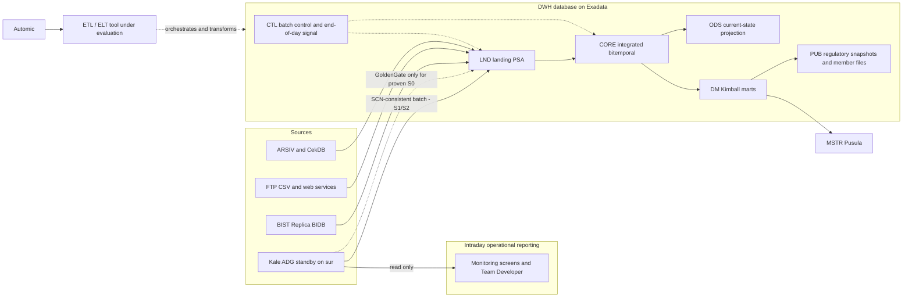

# ETL Tool Comparison

Comparison of five data-integration options for the Takasbank **on-premises enterprise data warehouse** on Oracle Exadata, written from the principal data warehouse architect's seat: **Oracle Data Integrator (ODI)**, **Informatica PowerCenter**, **dbt Core (+ dbt-oracle)**, **Cloudera Data Platform (Private Cloud)** and **Apache Spark**.

This note **owns the narrative comparison, the evaluation method, the PoC protocol and the decision record**. The cell-level data lives in the workbook and the canvas; the three artefacts carry the same numbers.

- Workbook: [Takasbank-ETL-Tool-Comparison.xlsx](../../outputs/etl-comparison/Takasbank-ETL-Tool-Comparison.xlsx) — scorecard with editable weights, rationale per cell, gates, capability matrix, use-case fit, latency/source coverage, profiles, TCO structure, risks, PoC plan, vendor questions, weight sensitivity, sources.
- Canvas: `takasbank-etl-tool-comparison.canvas.tsx` (interactive view of the same data, opened beside the chat in Cursor).

> [!warning] Status of the evidence
> Desk assessment from official documentation and the bank's own notes, as of **14 October 2026**. No candidate has been installed, tested or quoted at Takasbank. Ratings are architect judgement on a 0–5 scale; gates are provisional until the PoC in §9 is executed. This is an input to the steering committee, not a procurement ranking.

## 1. Executive summary

- **The decision is not "which ETL tool is best".** It is "which complete, supportable, fully on-premises service moves and transforms Oracle-heavy data into an Exadata EDW with the team Takasbank has, while intraday operational reporting is served from the Active Data Guard standby". Framed that way the field splits in two: tools that execute SQL **inside Exadata** (ODI, dbt, PowerCenter with pushdown) and platforms that move data **out** to a second compute estate and back (Cloudera, Spark).
- **Weighted result (baseline weights):** ODI **74.0**, dbt Core package **71.2**, PowerCenter **68.2**, Cloudera **53.6**, Spark **45.0** out of 100. Under six weight scenarios ODI leads four, dbt leads two (cost-constrained, engineering-culture), Cloudera and Spark never lead.
- **Lead commercial candidate: ODI.** Best architectural fit for an estate that is ~90% Oracle with a DBA/PL-SQL team: pure ELT pushdown, Oracle knowledge modules for MERGE/SCD/checks, Load Plans with restart, one vendor, local partners. Weaknesses: processor licence on Exadata cores, no log-based CDC without GoldenGate, a thin Git/test story, and Oracle's strategic investment sitting in OCI Data Integration rather than on-prem ODI.
- **Lead no-procurement candidate: dbt Core + dbt-oracle + Oracle-native ingestion + Automic.** Right transformation discipline (SQL in Git, tests, documentation, lineage graph, zero licence), the only option that can start **this month**, and the lowest exit cost. It is not a complete ETL service on its own: ingestion, file outputs, scheduling/HA and the publication gate come from Oracle features and Automic, and the bank must own a small framework.
- **Challenger with a hard condition: Informatica PowerCenter.** Broadest packaged connectivity and the most mature visual workflow, but the product's on-prem future is the single largest risk: BI Technology told the bank in 2024 that Informatica no longer sells on-prem, the strategic successor (CDI-PC / IDMC) uses a cloud control plane and fails the locality gate, the vendor changed hands (Salesforce), and the bank's only Informatica entitlement is TDM. Evaluate only against a **written five-year support commitment for a fully local edition**.
- **Not for EDW/ETL: Cloudera Data Platform.** A capable, well-governed platform (Ranger, Atlas, NiFi, Spark) that solves problems Takasbank does not have: 10 TB of relational data, an Oracle target, no lake, streaming or distributed-ML programme with a business case. It adds a second estate, a cluster team and a round trip back into Exadata. Keep on file for a future, funded lake/AI programme.
- **Not as a standalone product: Apache Spark.** Excellent engine primitives, but on its own it is not an integration service; everything around it (ingestion, CDC, orchestration, catalog, security, DR, support) is bank-built. At-least-once sinks into Oracle require engineering to avoid duplicate regulatory publications.
- **Real-time reporting is decided separately from the ETL tool.** Raw intraday current-state screens go to the ADG read-only standby; integrated near-real-time (S0) products, if any prove an SLA, need GoldenGate regardless of ETL tool. None of the five candidates is a CDC product; the comparison scores how well each **consumes** change data.
- **Recommended path (consistent with [[Başlangıç Yaklaşımı]]):** start Pilot A (SWIFT) now with the dbt/PL-SQL package and Automic; run the ODI PoC and commercial track in parallel on DSS; keep PowerCenter in the RFI only until its support horizon is answered in writing; close the selection at the **Pilot B exit gate** with measured evidence (§9) and record it in §11.

## 2. What Takasbank needs from the tool

Derived from the vault, not from vendor material. Every statement is a requirement the comparison answers.

### 2.1 Hard constraints

| # | Constraint | Source |
|---|---|---|
| H1 | Data cannot leave the institution; no SaaS or cloud control plane | [[Sistemler ve Servisler#2. Goldengate\|Goldengate]] §2.2 |
| H2 | Source and target are both Oracle Exadata (kale, sur, hisar); compute already purchased | [[Fiziksel Topoloji - Teknik Taraf]] |
| H3 | Prod Kale is never touched: no triggers, no MV logs, no dblinks; all Kale reads via the `sur` standby | [[Sistemler ve Servisler#2. Goldengate\|Goldengate]] §2.8 |
| H4 | Team is Oracle DBA + PL/SQL; IZV is 1 manager + 2 MSTR developers; no DWH/ETL experience; no 7/24 platform team; DBAs distrust GoldenGate | [[Obase Takasbank Değerlendirme Raporu Ağustos 2024]], [[Firmalarla Yapılan DWH Görüşmeleri]] |
| H5 | Procurement is slow; the pilot must not wait for a purchase | [[Başlangıç Yaklaşımı]] |
| H6 | Security from day one: PowerDesigner sensitivity flags, VPD/Redaction/TDE/audit in prod, Informatica TDM masking in non-prod, KVKK | [[DWH Hedef Mimarisi v2]] |
| H7 | Scheduling standard is Automic | [[Takasbank Genel Bilgilendirme 2]] |

### 2.2 Workload profile

- **Volume is modest, variety is not.** Kale ≈ 10 TB, ~7,000 main + ~3,000 backup tables, no ERD; satellites ARSIV, ÇekDB, BIST Replica BIDB (200 tables / 200 procedures, ~90% of end-of-day flow Replica → Kale), FTP/CSV, EPİAŞ web services, possible Postgres/MSSQL.
- **Operational reporting dominates.** Team Developer, React screens, MSTR Pusula (10–20% migrated), member terminal reports; most intraday "izleme" screens are current-state queries on raw Kale structures ([[Banka Ug]], [[Takasbank Genel Bilgilendirme 2]]).
- **Regulatory outputs with hour-based SLAs** (SPK, MASAK, BDDK, Hazine) join several markets; as-originally-reported and corrected versions must be kept ([[Aktif Sorular]] 1).
- **Latency classes** from [[DWH Hedef Mimarisi v2]]: S0 near-real-time, S1 intraday micro-batch, S2 end-of-day, S3 file/external, S4 backfill. The architectural stance is batch first; S0 only where a product proves its SLA.
- **No machine-readable end-of-day signal yet**; two conflicting end-of-day timelines; historical rows receive updates; Borsa contract data is deleted after 5 days ([[Ortamlar hakkında]], [[DWH Sunum Temmuz 2025]]).
- **Pilot workloads** ([[DWH Sunum Temmuz 2025]]): SWIFT legal reports (1M messages/day, 2 billion rows / 170 GB → ~24M summary rows), Fon Bilgilendirme (intraday 08:00–17:45 with corrections, 10-year history via CSV and web service), Fon İşlem Defterleri (9M contracts/day cleansed to ~600k, files to Verda twice a day per market), BISTECH SPK 13 reports (two Oracle sources, end-of-day dependent).

### 2.3 Target architecture the tool must serve

The tool under evaluation owns **LND → CORE → ODS/DM → PUB** transformations and the file/landing legs; it does not own intraday raw reporting (standby) and it does not replace GoldenGate for S0.

## 3. Evaluation method

### 3.1 Mandatory gates (pass/fail, outside the score)

| ID | Gate | ODI | PowerCenter | dbt Core | Cloudera | Spark |
|---|---|---|---|---|---|---|
| G1 | Fully on-premises; no data egress; no cloud control plane | Pass | **Conditional** — classic PowerCenter only; CDI-PC/IDMC fails | Pass (dbt Core; dbt Cloud fails) | Conditional (PvC Base only) | Pass |
| G2 | Exadata is source and target; transformations execute set-based inside the database | Pass | Conditional — Pushdown Optimization licensed and proven | Pass | **Fail** | **Fail** |
| G3 | Supportable without a 7/24 platform team | Pass | Conditional — written 5-year on-prem horizon | Conditional — partner support contract | **Fail** | **Fail** |
| G4 | Integrates with Oracle TDE/VPD/Redaction/Unified Audit, secrets, auditability | Pass | Pass | Pass | Pass | Conditional |

A single Fail eliminates. Cloudera and Spark fail G2 and G3 **as the DWH transformation layer**; they remain on the sheet to document why, and because Cloudera could return as an adjacent platform under a different programme.

### 3.2 Weighted criteria

| ID | Criterion | Weight | What it measures |
|---|---|---|---|
| C1 | Oracle / Exadata architectural fit | 14 | ELT pushdown, SCN-consistent extraction, partition exchange/HCC awareness, no second estate |
| C2 | Source connectivity and ingestion | 10 | Standby, ARSIV/ÇekDB, Replica BIDB, FTP/CSV, web services, Postgres/MSSQL, file outputs |
| C3 | Change capture and latency classes | 10 | S0/S1/S2 coverage without touching prod Kale |
| C4 | Transformation depth and data correctness | 12 | MERGE, SCD2/bitemporal, dedup, late corrections, DQ, reconciliation, idempotent replay |
| C5 | Orchestration, operational-report SLA and recovery | 10 | Automic, end-of-day event, hour deadlines, restart, HA/DR |
| C6 | Security, metadata, lineage and audit | 10 | Oracle security integration, secrets, PowerDesigner flags, column lineage, immutable snapshots |
| C7 | Developer experience and change management | 8 | Git, tests, CI/CD, environment promotion, rollback |
| C8 | Team fit and skills | 10 | Fit with the Oracle team, learning curve, local skills market, knowledge concentration |
| C9 | Operating burden, HA/DR, support and roadmap risk | 8 | Components to run, 7/24 expectations, vendor presence, 5-year on-prem roadmap |
| C10 | Five-year TCO and procurement friction | 8 | Licences, hardware, implementation, run, exit; speed of procurement |

Rating scale: 0 demonstrably fails · 1 major gaps · 2 partial, heavy manual work · 3 meets with known limitations · 4 meets well with minor conditions · 5 meets fully, production-proven for this pattern. Points = weight × rating / 5.

### 3.3 Evaluated solution shapes

Each candidate is rated as the **complete solution it would be at Takasbank**, not as a bare product:

| Candidate | Evaluated shape |
|---|---|
| ODI | ODI 12c EE; repositories in the DWH DB; standalone/JEE agents on Exadata or a VM pair; OEM plugin; GoldenGate only for proven S0 |
| PowerCenter | PowerCenter 10.5.x fully on-prem; PowerExchange CDC for Oracle; Pushdown Optimization; local partner support |
| dbt Core | dbt Core 1.x + dbt-oracle; Git; Automic as scheduler; ingestion via external tables, dblink from the ADG standby, SQL*Loader; PL/SQL file-writer package; Oracle Database Gateway only if Postgres/MSSQL confirmed |
| Cloudera | CDP Private Cloud Base 7.x with NiFi (CFM), Spark, Hive/Impala, Ranger, Atlas, Knox, Kerberos; JDBC bridge to Exadata; DR cluster |
| Spark | Spark 3.5/4.x on a bank-run cluster; Airflow; object/HDFS storage; Kafka if streaming; custom ingestion, catalog, secrets, monitoring |

## 4. Scorecard

| ID | Criterion | W | ODI | PowerCenter | dbt Core | Cloudera | Spark |
|---|---|---|---|---|---|---|---|
| C1 | Oracle / Exadata fit | 14 | **5** | 3 | 4.5 | 1.5 | 1.5 |
| C2 | Connectivity and ingestion | 10 | 4 | **5** | 3 | 4 | 3 |
| C3 | Change capture and latency | 10 | 3 | **3.5** | 2 | 2.5 | 2 |
| C4 | Transformation and correctness | 12 | **4** | **4** | **4** | 3 | 3 |
| C5 | Orchestration, SLA, recovery | 10 | **4** | **4** | 2.5 | 3 | 2 |
| C6 | Security, metadata, lineage | 10 | 3 | 4 | 3.5 | **4.5** | 1.5 |
| C7 | Developer experience | 8 | 3 | 2.5 | **5** | 3.5 | 4 |
| C8 | Team fit and skills | 10 | **4** | 3 | 3.5 | 1.5 | 1.5 |
| C9 | Operating burden and roadmap | 8 | **4** | 2 | 3 | 2 | 1.5 |
| C10 | Five-year TCO and procurement | 8 | 2 | 2.5 | **4.5** | 1.5 | 3 |
| | **Total / 100** | 100 | **74.0** | 68.2 | 71.2 | 53.6 | 45.0 |
| | Gate outcome | | Eligible | Conditional | Conditional | Eliminated | Eliminated |

Cell-level rationale for all 50 ratings is on the workbook sheet **Criteria Detail**.

### 4.1 Weight sensitivity

| Scenario (weights re-balanced, Σ = 100) | ODI | PowerCenter | dbt Core | Cloudera | Spark | Leader |
|---|---|---|---|---|---|---|
| Baseline (architect's weights) | 74.0 | 68.2 | 71.2 | 53.6 | 45.0 | ODI |
| Cost-constrained (C10 = 20) | 69.6 | 64.8 | **74.2** | 49.8 | 47.0 | dbt Core |
| Real-time heavy (C3 = 20) | **73.2** | 69.2 | 66.2 | 53.6 | 44.0 | ODI |
| Governance / audit heavy (C6 = 20) | **72.0** | 68.8 | **72.0** | 57.6 | 44.0 | tie ODI / dbt |
| Team-fit heavy (C8 = 20) | **74.4** | 65.6 | 71.6 | 50.0 | 43.4 | ODI |
| Engineering-culture heavy (C7 = 18) | 71.6 | 65.2 | **75.4** | 54.4 | 49.6 | dbt Core |

Reading: the ranking between ODI and the dbt package is **not robust to priorities** and should be settled by the pilots and the ODI quote, not by the spreadsheet. The ranking of PowerCenter (third), Cloudera (fourth) and Spark (fifth) **is** robust.

## 5. Candidate profiles

### 5.1 Oracle Data Integrator

**What it is.** Oracle's ELT tool: a metadata repository (master + work) in an Oracle schema, a thin agent that generates SQL from declarative mappings and knowledge modules (KM) and runs it in the target database, Load Plans for orchestration, ODI Studio for development, an Enterprise Manager plugin for operations.

**How it would be deployed here.** Repositories in the DWH database on `sur` or `hisar`; two standalone agents (active/passive) or a JEE agent on WebLogic for HA; Studio on developer PCs; Oracle sources read from the `sur` standby via dblink/JDBC with `AS OF SCN`; files via LKM File to Oracle (external table); BIST Replica BIDB via dblink; outputs via IKM SQL to File. Automic calls `startloadplan` or the agent REST API after the end-of-day batch-control record.

**Strengths.**
- Native pushdown: Exadata does the work; the agent moves no rows for Oracle-to-Oracle flows.
- Oracle KMs for incremental update (MERGE), SCD, check constraints with error tables, partition exchange, direct-path loads; existing PL/SQL procedures can be called as-is (Ondata confirmed this in 2024).
- Load Plans with hierarchy, parallelism, exception handling and **restart from the failed step** — exactly what hour-SLA regulatory chains need.
- Fits the team's Oracle mindset; ODI developers and partners exist in Türkiye; one support contract.
- Reads GoldenGate-landed journals natively (JKM GoldenGate) if S0 is ever proven.

**Weaknesses.**
- No log-based CDC of its own; trigger-based journalising is forbidden on prod Kale and impossible on a read-only standby.
- Processor licence on Exadata cores is the cost driver; a new Oracle purchase through slow procurement.
- Git integration exists (12.2.1.2.6+) but is object export/import, not code-first; automated testing is not native.
- Oracle's strategic investment is OCI Data Integration; on-prem ODI is maintained, not advanced. Get lifecycle dates in writing.
- Repository objects are proprietary; exit cost high although generated SQL is portable.

**Verdict.** Lead commercial candidate. Eligible on all gates.

### 5.2 Informatica PowerCenter

**What it is.** The classic enterprise ETL suite: a domain with repository and integration services, a row-processing engine with hundreds of transformations, Workflow Manager/Monitor, PowerExchange for CDC and non-relational sources, Pushdown Optimization to execute logic in the database.

**How it would be deployed here.** Domain on two VMs (grid for HA), repository in Oracle, PowerExchange CDC listener/logger near the source if S0/S1 is required, developer clients. Pushdown Optimization must be licensed and used for Oracle-to-Oracle flows or Exadata capacity is wasted moving rows through the Integration Service.

**Strengths.**
- Broadest packaged connectivity (files, FTP, web services, MQ, SAP, mainframe), file generation for members/Verda is routine.
- Mature workflow recovery, operations tooling, role model; Informatica developers exist in Turkish banks.
- PowerExchange CDC for Oracle is log-based and production-proven, giving a CDC route that does not depend on GoldenGate.
- TDM is already in-house; existing vendor relationship may help commercially.

**Weaknesses.**
- **Roadmap risk is the decisive issue.** BI Technology stated in 2024 that Informatica no longer sells on-prem; the strategic successor (CDI-PC / IDMC) keeps data local but uses a cloud control plane, which fails H1/G1; Salesforce's acquisition adds uncertainty for on-prem products.
- Engine-centric by default; pushdown changes reject handling and recovery and must be proven (PoC P03, P04).
- Weakest change-management story: repository versioning and deployment groups, no native Git, testing via a separate product.
- Two CDC products (PowerExchange + GoldenGate) in one estate if both ever exist.

**Verdict.** Challenger only with a written five-year support commitment for a fully local edition and a competitive quote; otherwise drop at the RFI stage.

### 5.3 dbt Core + dbt-oracle (with Oracle-native ingestion and Automic)

**What it is.** dbt Core is an Apache-2.0 transformation framework: SQL models with Jinja templating, dependency graph, incremental and snapshot (SCD2) materialisations, schema/data/unit tests, contracts, documentation and lineage generated from code. `dbt-oracle` is the adapter maintained by Oracle on GitHub (python-oracledb thin/thick). dbt does **no** ingestion, scheduling or HA.

**How it would be deployed here.** Git repository per domain; dbt runs from an Automic agent host (Python venv, Instant Client or thin mode, wallet authentication) against the DWH database; landing is Oracle-native: external tables / SQL*Loader for files, dblink or scheduled extracts from the ADG standby with `AS OF SCN`, Database Gateway only if Postgres/MSSQL sources are confirmed; file outputs via a PL/SQL (`UTL_FILE`) package or a small service; dbt docs published on an internal web server; CI runs `dbt build` on PREPROD/DSS.

**Strengths.**
- 100% pushdown SQL; nothing to operate beyond a CLI and Git; lowest exit cost (SQL + Jinja).
- Best engineering discipline of the five: pull requests, automated tests, documentation and lineage as by-products of development; directly addresses the knowledge-concentration lesson from Vakıfbank ([[DWH Sunum Aralık 2024]]).
- Can start **without procurement**, which is the only way Pilot A starts on time (H5).
- SQL-first: PL/SQL people are productive in weeks; UG analysts can read the models.
- Zero licence; cost is people and a partner contract.

**Weaknesses.**
- Not a complete ETL service: ingestion, file outputs, scheduler, HA and the publication gate must be assembled from Oracle features, Automic and a small framework the bank owns.
- No vendor SLA; adapter maintained by Oracle outside dbt Labs; the newer dbt Fusion engine does not cover Oracle, so the Oracle path stays on dbt Core (stable but not where dbt Labs/Fivetran invest).
- Column-level lineage is a dbt Cloud/Fusion feature; Core gives model-level lineage, so regulator-grade column lineage needs an export step.
- Code-first culture must be accepted by UG analysts; smaller local partner pool than ODI/Informatica.

**Verdict.** Lead no-procurement candidate and a credible long-term choice if the pilots show the team sustains the engineering discipline. Conditional on G3 (partner support).

### 5.4 Cloudera Data Platform (Private Cloud Base)

**What it is.** The on-prem Hadoop-lineage platform: HDFS/Ozone storage, YARN/Kubernetes compute, Hive/Impala/Spark engines, Iceberg tables, NiFi (Cloudera Flow Management) for ingestion, Kafka (Streams Messaging), Ranger/Atlas/Knox/SDX for governance, Cloudera Data Engineering (Airflow) and Machine Learning as optional services.

**How it would be deployed here.** A 6–10 node production cluster plus DR, Kerberos, a NiFi cluster, Ranger/Atlas, a JDBC bridge to Exadata; a platform team of 4–6 with 7/24 cover; Komtaş-type partner for implementation. Every DWH dataset would travel Oracle → cluster → Oracle.

**Strengths.**
- Strongest built-in governance of the five (Ranger row/column policies and masking, Atlas column lineage, SDX).
- NiFi is excellent for files, FTP, REST and delivery tracking; Kafka/Spark Streaming give real streaming plumbing.
- The only candidate with distributed ML/lakehouse capability; vendor support and local partners exist.

**Weaknesses.**
- **Fails G2 and G3 for this programme.** Exadata compute goes unused while a second estate is bought, built and staffed for 10 TB of relational data whose target is Oracle.
- Oracle log CDC still needs GoldenGate (NiFi has no Oracle CDC processor; Debezium LogMiner against prod violates H3 and is unsupported by Oracle).
- Widens the KVKK/security perimeter: sensitive copies outside Exadata; a second security domain to govern.
- Highest five-year cost and the scarcest skills relative to the problem size.

**Verdict.** Not for EDW/ETL. Revisit only if a funded lake/streaming/AI programme with a business case appears; even then as an adjacent platform fed from the DWH, not a replacement.

### 5.5 Apache Spark (standalone)

**What it is.** An open-source distributed compute engine (Spark SQL, DataFrames, Structured Streaming, MLlib). On its own it is not a product: no ingestion service, no CDC, no scheduler, no catalog, no security model, no support.

**How it would be deployed here.** A 4–8 node cluster (standalone/K8s/YARN), Airflow, object or HDFS storage, Kafka if streaming, a catalog (e.g. OpenMetadata), secrets and monitoring — all selected, integrated and operated by the bank.

**Strengths.**
- Open source, no licence; powerful engine for heavy transformations and ML; code in Git with unit tests.

**Weaknesses.**
- Same Oracle → cluster → Oracle round trip as Cloudera without the platform; JDBC partitioned reads and batch writes to Oracle are the bottleneck.
- Everything around the engine is bank-built and bank-run; no vendor; hardest hiring profile for this scale.
- At-least-once sink semantics into Oracle must be engineered away for regulatory publications.
- **Fails G2 and G3.**

**Verdict.** Not as a standalone product. Spark may appear as an engine inside a platform (Cloudera) or for a niche workload; it is not a DWH integration layer for an Oracle target.

## 6. Fit against Takasbank workloads

| Workload (latency) | ODI | PowerCenter | dbt Core | Cloudera | Spark | Note |
|---|---|---|---|---|---|---|
| UC1 SWIFT legal reports — Pilot A (S2) | Strong | Good | Strong | Weak | Weak | Pure SQL summarisation on Exadata; cluster options would export 170 GB for a regex job Oracle does in place |
| UC2 BISTECH SPK 13 reports — Pilot B (S2, end-of-day signal) | Strong | Good | Good | Weak | Weak | Load Plans map to the step chain; dbt needs Replica BIDB landed first |
| UC3 Fon Bilgilendirme (S1, 08:00–17:45 corrections) | Good | Good | Good | Fair | Fair | Micro-batch with recompute-by-fund keys; CDC not required if a reliable change timestamp exists — verify |
| UC4 Fon İşlem Defterleri — Verda files (S1, twice daily per market) | Strong | Strong | Fair | Good | Fair | File-heavy; dbt needs a file writer; NiFi delivers files well but computation belongs in Oracle |
| UC5 Intraday "izleme" screens, Team Developer (S0/S1 raw) | N/A | N/A | N/A | N/A | N/A | Not an ETL problem: ADG standby; GoldenGate only for a proven integrated S0 product |
| UC6 Hour-SLA regulatory outputs (S2 hard deadline) | Strong | Good | Good | Fair | Weak | Deadline in Automic; restart and reconciliation gate decide |
| UC7 Member file deliveries (pilot candidate) | Strong | Strong | Fair | Good | Fair | As UC4 |
| UC8 Archive offload banka → banka_old → arşiv into HCC (S2) | Strong | Fair | Strong | Poor | Poor | Oracle-to-Oracle bulk with partition exchange; a lake contradicts the target |
| UC9 AI/ML feature preparation (future) | Fair | Fair | Good | Strong | Strong | Only area where cluster options lead; no business case yet; Oracle 23ai covers in-database ML at this scale |

### 6.1 Real-time and operational reporting

The notes ask whether "anlık" reports can come from the DWH ([[Aktif Sorular]] 3). The answer does not depend on the ETL tool:

1. **Raw current state on Kale structures** (most "izleme" screens, Team Developer): Active Data Guard read-only standby on `sur`. Zero modelling, zero new tools; precondition is the ADG licence/open-mode verification ([[Aktif Sorular]] 14.1).
2. **Integrated current state with a measured operational SLA** (an `ODS_*` projection over CORE): S1 micro-batch from the standby is the default; only if a product proves a sub-minute requirement does GoldenGate enter, and then as a landing feed for whichever ETL tool is chosen.
3. **Intraday computed products** (Fon Bilgilendirme recomputes, Fon İşlem Defterleri): S1 micro-batch orchestrated by Automic; ODI, PowerCenter and dbt all handle this; cluster options add a round trip.

Consequence for the comparison: C3 rewards how well a tool **consumes** change data and runs micro-batches, not whether it ships its own CDC. PowerCenter scores highest because PowerExchange is a credible log-based CDC route; ODI and dbt both depend on GoldenGate for S0.

## 7. Five-year cost structure

No quotes exist; the workbook sheet **TCO Model** holds the line items and amber cells for prices. Expected cost classes:

| Cost line | ODI | PowerCenter | dbt Core | Cloudera | Spark |
|---|---|---|---|---|---|
| Licence / subscription | High (processor × Exadata cores) | High (+CDC, +pushdown) | None | High (nodes) | None |
| Hardware | Low | Low–Medium | Low | High (+DR) | Medium–High |
| Implementation partner | Medium | Medium | Low–Medium | High | High |
| Incremental staffing | 2 developers | 2 developers + admin | 2 engineers + framework owner | 4–6 + 7/24 | 3–4 + 7/24 |
| Run cost | Medium | Medium | Low | High | High |
| Framework build | Low–Medium | Low–Medium | Medium | Medium | High |
| Exit cost | High | High | Low | High | Medium |
| Procurement lead time | Months | Months | None | Months | Hardware only |

Decision rule for the commercial track: the ODI quote is compared with the **fully loaded** dbt package (partner contract + framework build + one additional engineer-year), not with "free".

## 8. Risk register (top items)

| Candidate | Risk | L | I | Mitigation / rule |
|---|---|---|---|---|
| ODI | Processor licence on Exadata exceeds budget | M | H | Quote with target-core definition; capacity-on-demand; bundle with Oracle renewal |
| ODI | Oracle de-prioritises on-prem ODI | M | M | Lifecycle dates in contract; keep SQL/models portable; Git export |
| ODI | "Drag-and-drop" culture skips engineering discipline | M | M | Mandatory Git, naming standards, review of generated SQL, automated reconciliation tests |
| PowerCenter | On-prem edition reaches end of support within the DWH lifetime | H | H | No selection without written 5-year commitment |
| PowerCenter | Successor requires cloud control plane | H | H | CDI-PC out of scope |
| dbt Core | Framework gaps underestimated | M | H | Scope framework explicitly in Pilot A; time-box |
| dbt Core | No vendor SLA for adapter incidents | M | M | Partner contract; pinned versions; adapter is thin and forkable |
| dbt Core | Code-first rejected by UG culture | M | M | Pair UG analysts with engineers; dbt docs as shared artefact; measure in pilot |
| Cloudera | Second platform for 10 TB of Oracle data | H | H | Do not adopt as ETL |
| Spark | Bank becomes its own platform vendor | H | H | Do not adopt standalone |
| All | GoldenGate licence / ADG mode assumptions false | M | H | Verify with DBA before any S0 commitment ([[Aktif Sorular]] 14.1–14.2) |
| All | Tool purchase blocks the first business outcome | H | H | Start Pilot A with the no-procurement option; decide at Pilot B gate |

Full register: workbook sheet **Risks**.

## 9. Proof of concept and acceptance protocol

Run on **DSS** (prod-equivalent, read-only sync) with the ADG standby as the Oracle source. Workloads: **W1** SWIFT summarisation (250M rows), **W2** BISTECH SPK chain, **W3** Fon Bilgilendirme micro-batch, **W4** Fon İşlem Defterleri files.

| Test | Name | Pass criterion |
|---|---|---|
| P01 | Disconnected operation | Full load plan runs with outbound internet blocked; no telemetry/licence calls required |
| P02 | SCN-consistent extraction from standby | Five related tables `AS OF` one SCN during intraday activity; counts and FK integrity match; no load on prod |
| P03 | Exadata pushdown efficiency (W1) | ≥90% of DB time inside Oracle; within window; no row-by-row movement through the tool host |
| P04 | Restart after partial failure | Kill mid-load after partial commit; restart from failed step; no duplicates; no manual cleanup |
| P05 | Late correction and bitemporal history | Backdated update closes old system version, inserts new; marts reflect it; replay identical |
| P06 | Replay / backfill from landing | Re-run business date D with new load id; idempotent; prior publication versions preserved |
| P07 | Intraday micro-batch (W3) | 15-minute freshness; only corrected funds recomputed |
| P08 | File-heavy workload (W4) | Ledger files byte-compare with legacy output; delivery proof recorded |
| P09 | Security integration | Least-privilege service account; VPD/Redaction respected; secret rotation; audit export |
| P10 | Lineage export | Column-level source-to-report lineage for one SPK report generated, not hand-written |
| P11 | Automic integration and end-of-day event | Start/stop/status round trip; failure visible in Automic within 1 minute |
| P12 | Operate for 10 days | Bank DBA team runs the chain daily with the runbook, without vendor; MTTR recorded |

Gate mapping: G1 ← P01; G2 ← P03; G3 ← P12; G4 ← P09. Results are entered in the workbook sheet **PoC Plan**.

## 10. Vendor / RFI questions

- **Oracle:** exact ODI EE licence metric with agents on Exadata (which processors count; capacity-on-demand); Premier/Extended support dates for ODI 12.2.1.4 on-prem and whether a next on-prem release is committed; confirmation of the GoldenGate entitlement claimed in the 2024 Obase report; Turkish banking references running ODI on Exadata with Load Plan restart in production.
- **Informatica:** is a fully on-prem PowerCenter edition sold and supported for 5+ years — end-of-support schedule in writing; PowerExchange CDC for Oracle licence and whether it can mine a downstream/standby database; Pushdown Optimization licence and behavioural differences; post-acquisition roadmap statement for on-prem products.
- **dbt / partner:** which Turkish partner provides incident support for dbt Core + dbt-oracle, with what SLA and escalation to Oracle for adapter defects; confirmation of adapter support for the Oracle features in use (partition exchange macros, `DBMS_PARALLEL_EXECUTE`, wallet authentication).
- **Cloudera / Komtaş:** minimum supported production + DR footprint with NiFi and Ranger/Atlas; node pricing; required admin headcount; supported Oracle CDC pattern without GoldenGate.
- **Spark consultancy:** reference architecture for Oracle → Spark → Oracle with exactly-once publication; who owns the platform at run time.

Full list with answer columns: workbook sheet **Vendor Questions**.

## 11. Recommendation and decision record

### 11.1 Recommendation

1. **Start Pilot A (SWIFT) now with the no-procurement package**: dbt Core + dbt-oracle (or the PL/SQL framework if the team prefers), Git, Automic, external tables, SCN-consistent extraction from the standby. This proves the platform plumbing ([[Proje Planı]] Faz 1) without waiting for a purchase.
2. **Run the ODI track in parallel**: RFI answers, quote with the Exadata core definition, PoC P01–P12 on DSS using W1 and W2. ODI is the only commercial candidate that is eligible on all four gates today.
3. **Keep PowerCenter in the RFI only until the support-horizon question is answered in writing.** Without a five-year fully-local commitment it leaves the shortlist.
4. **Close Cloudera and Spark for this programme** and record why (G2/G3). Keep the Cloudera profile on file for a future lake/AI programme with its own business case.
5. **Decide at the Pilot B exit gate** ([[Proje Planı]] Faz 2) between ODI and the dbt package using the measured evidence. Decision rules:
   - ODI if the quote is within budget, P03/P04 pass, and the team prefers the visual/KM model after having run dbt for one pilot.
   - dbt package if the ODI quote is disproportionate to a 10 TB estate, or the team has sustained Git/test discipline through both pilots and the framework gaps proved small.
   - A hybrid (ODI for file/landing/orchestration, dbt for CORE/DM) is possible but doubles metadata; choose it only if a specific gap in the winner is proven.
6. **Decide real-time separately**: ADG standby verification first ([[Aktif Sorular]] 14.1), GoldenGate only for a product with a proven S0 SLA and a confirmed licence ([[Aktif Sorular]] 14.2).

### 11.2 Decision record (to be completed at the Pilot B exit gate)

| Field | Entry |
|---|---|
| Decision | *pending* |
| Date / forum | *pending* — steering committee |
| Options considered | ODI · PowerCenter · dbt Core package · Cloudera CDP · Apache Spark |
| Gate results | G1–G4 per candidate from PoC P01, P03, P09, P12 |
| Scorecard at decision | Workbook **Scorecard** with approved weights; sensitivity reviewed |
| Commercial basis | ODI quote vs fully loaded dbt package; PowerCenter only if commitment received |
| Pilot evidence | Pilot A Kale DB-time reduction vs baseline; Pilot B reconciliation and parallel-run acceptance |
| Consequences | Licensing, staffing, training, framework ownership, exit plan |
| Review date | 12 months after go-live of the second data product |

## 12. Open items that affect the choice

- ADG licence and open mode of the `sur` standby — [[Aktif Sorular]] 14.1.
- GoldenGate entitlement (Obase says present, DBA notes say new licence) — [[Aktif Sorular]] 14.2.
- Which pilot tables have a reliable change timestamp (decides S1 without CDC) — [[Proje Planı]] Faz 0 source profiling.
- Direct read permission on BIST Replica BIDB — [[Aktif Sorular]] 15.2.
- Whether Postgres/MSSQL sources actually exist — [[Sistemler ve Servisler#4. ODS|ODS]] §4.1.
- End-of-day completion event — [[Proje Planı]] Faz 0 "iki ucuz kazanım".

İlgili notlar: [[Başlangıç Yaklaşımı]] · [[Proje Planı]] · [[Sistemler ve Servisler#2. Goldengate|Goldengate]] · [[DWH Hedef Mimarisi v2]] · [[Fiziksel Topoloji - Teknik Taraf]] · [[DWH Sunum Temmuz 2025]] · [[Firmalarla Yapılan DWH Görüşmeleri]] · [[Obase Takasbank Değerlendirme Raporu Ağustos 2024]] · [[Komtaş Future-Ready Data Platform Teklifi Ağustos 2026]] · [[Aktif Sorular]]
