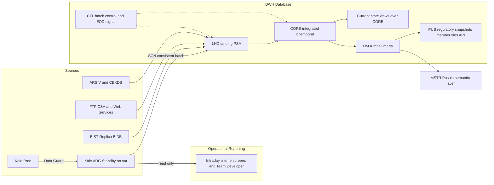

# Takasbank DWH — How I Would Proceed

## What the notes tell me about this bank (the constraints that shape everything)

- **Not a retail bank; a post-trade FMI.** CCP, clearing/settlement, payments (TETS/EFT/SWIFT), cheque clearing, TEFAS/BEFAS, BES pension fund tracking, energy/commodity settlement, LEI/ISIN. The durable cross-market concepts are party/member, account, instrument, market×service, calendar, obligation→instruction→movement ([Takasbank İş Alanları ve Temel Varlıklar](Obsidian Vault/Takasbank İş Alanları ve Temel Varlıklar.md)).
- **One monolith source.** ~90% of data in `Kale` (Oracle Exadata, ~10 TB, ~7,000 main + ~3,000 backup tables, no ERD, member tables duplicated per schema). Satellites: ARSIV (yearly `banka → banka_old → arşiv` rollover), CEKDB, BIST Replica BIDB (200 tables/200 procs, 90% of EOD flow is Replica→Kale), FTP/CSV, EPİAŞ web services ([Sistemler ve Servisler](Obsidian Vault/Sistemler ve Servisler.md), [Firmalarla Yapılan DWH Görüşmeleri](Obsidian Vault/Takasbank/Firmalarla Yapılan DWH Görüşmeleri.md)).
- **Hardware is not the problem.** Three Exadatas, 77–90% disk free, `sur` CPU ~6–12%, `hisar` ~2–3%. Kale already has two Data Guard replicas, one on `sur` ([DWH Sunum Aralık 2024](Obsidian Vault/Takasbank/DWH Sunum Aralık 2024.md), [Fiziksel Topoloji](Obsidian Vault/Kendi Notlarım/Fiziksel Topoloji - Teknik Taraf.md)).
- **People are the constraint.** BI team = 1 manager + 2 MSTR developers; strong Oracle DBA/PL-SQL; no DWH/ETL experience; UG analysts hold the table knowledge; DBAs distrust GoldenGate and have no 24/7 team. Procurement is slow; data cannot leave premises.
- **Operational reporting dominates.** Team Developer (legacy), React screens (UG), MSTR "Pusula" (10–20% migrated), member terminal reports, SPK/MASAK/BDDK/Hazine outputs with hour-level SLAs. Many "izleme" screens are effectively intraday current-state queries on Kale.
- **No machine-readable end-of-day.** Completion is a manual email; two conflicting EOD timelines in the notes. Historic rows get updated. Borsa contract data is deleted after 5 days.

## Architecture stance (where I deviate from the repo's v2 and from the vendor proposals)

1. **Oracle on Exadata only.** No Cloudera/Spark/Kafka. At 10 TB with an Oracle team, a second platform is pure staffing cost. The ETL evaluation workbook stays, but Cloudera/Spark are only there to document why they lose.
2. **Serve intraday operational reporting from an Active Data Guard read-only standby, not from GoldenGate and not from a new "ODS" database.** The `sur` replica of Kale already exists; opening it read-only (verify ADG licence and open mode with DBAs) and re-pointing "izleme" screens and Team Developer queries to it is the fastest, lowest-risk Kale offload, needs no new tool, no modelling, and the DBAs already run it. `tvsods` is retired: it is a third copy of Kale on the machine we are trying to unload.
3. **No separate physical ODS at the start.** Integrated current-state is a projection over the core (views/MVs) opened only where a measured SLA demands it. Raw current-state is the standby. This collapses the Obase "ODS first" and the v2 "ODS as projection" positions into one testable rule.
4. **DWH database placement is a test, not a slide.** Prior decks put DWH on `sur` next to PREPROD/DSS/TRUVA and 10 other DBs. `hisar` is nearly idle and already hosts ARSIVDB; co-locating history there is attractive. Decide after an IO/CPU isolation test with the DBA team.
5. **Ingestion by latency class, batch first.** S2 end-of-day via SCN-consistent extraction from the standby (`AS OF SCN` across tables), S1 microbatch only where change columns are proven reliable, S0 CDC only when a product proves the SLA and the GoldenGate licence claim (Obase says it exists, DBAs say new) is verified. Nothing touches prod Kale directly; no triggers, no MV logs, no dblinks.
6. **Transformation = SQL/PL-SQL pushdown in the DWH.** Start the pilot with what needs no procurement (PL/SQL framework or dbt-core + dbt-oracle, Git, automated tests). Run the ODI/Informatica evaluation in parallel and decide at the pilot exit gate with measured evidence, instead of blocking the pilot on a purchase.
7. **Model = iterative integrated core + Kimball marts; no Data Vault.** Conformed party/member, account, instrument, market×service, calendar and settlement-rule (versioned, because T+2→T+1 lands by end-2026). Bitemporal columns only on entities where historic updates are proven. MSTR semantic layer sits on marts only.
8. **Archive becomes a DWH responsibility.** The yearly `banka_old` rollover and 3,000 backup tables are a hand-rolled partitioning scheme. Once history lives in the DWH, Kale keeps a rolling window; that is the real long-term storage/IO relief, and it should be a stated programme objective.
9. **Security is designed on day one.** PowerDesigner sensitivity flags seed classification; prod DWH is unmasked but protected with VPD/Data Redaction + TDE + audit; non-prod masked with the existing Informatica TDM. The current practice of SPK users reading views over a dblink into DB_ARSIV is replaced by an audited `PUB` schema with versioned, immutable regulatory snapshots.

## Phase 0 — First 30 days: facts, mandate, and two cheap wins

**Mandate and governance (week 1)**

- Named sponsor, steering cadence, and decision rights for "which number is correct" per domain (reuse [DWH Ownership Operating Model](Obsidian Vault/Kendi Notlarım/DWH Ownership Operating Model.md), slimmed to the roles that exist today: BI team, UG analysts, DBAs, BT Mimari, operations).
- Agree the programme's primary KPI: measured Kale DB-time reduction attributable to reporting, plus EOD duration. Everything else is secondary.

**Measure, don't interview (weeks 1–4, in parallel)**

- Kale workload study: 4 weeks of AWR/ASH; top SQL by DB time split into daytime screens, Team Developer, MSTR, UG EOD procedures. This tells us what to offload first and sizes the standby win.
- Report inventory from logs, not surveys: Team Developer usage, React report endpoints, MSTR execution logs, regulatory outputs, member files. Tag each with latency class (S0–S4), criticality, source schemas, owner.
- Source profiling on the standby: largest/fastest-growing tables (BES claimed ~80%), PK presence, reliable change timestamps, in-place updates to history, delete patterns, schema-per-market duplicates of member/account.
- Verify three claims that change the architecture: ADG licence/open mode of the `sur` replica; GoldenGate licence status; whether the UG EOD summary procedures can run against the standby.

**Two cheap wins that de-risk everything later**

- Build the batch-control table and an EOD completion event (business date, run id, SCN) with the operations team, replacing the email as the machine dependency. Reconcile Deniz's 21:30–06:00 and Ozan's 03:00/04:00–07:00 timelines while doing it.
- Start landing BIST fund contract data (9M rows/day, deleted after 5 days at source) into `LND` immediately, before any modelling. History that is not captured now is gone.

**Team (weeks 2–4)**

- Secure 1 data modeller, 2 data engineers (Oracle-strong), rotating UG analyst secondments per slice, and a DBA liaison. Training for the MSTR developers on dimensional modelling. Decide consultancy use: a bounded build-with-us partner for the pilot, not a 3-month paper design study (the Komtaş proposal as scoped delivers an RFP, not a warehouse).

**Phase 0 exit gate:** report inventory with routing (standby / DWH / stays in app), ranked pilot list, verified licence facts, EOD signal in place, capacity and placement test results.

## Phase 1 — Platform foundation through Pilot A (SWIFT legal reports)

Why first: single source schema, T-1 is acceptable, 2bn rows / 170 GB with free-text identity search is a visible Kale win, clear regulatory consumers, and it forces the security design (TCKN in free text). It does not need conformed member/market dimensions, so it proves the plumbing without the modelling debate ([DWH Sunum Temmuz 2025](Obsidian Vault/Takasbank/DWH Sunum Temmuz 2025.md)).

- `CTL`/`LND` standards, SCN-consistent extraction from the standby, replay/backfill with separate load ids, Automic chain hanging off the EOD event.
- Core message entity + extracted identifier table; `PUB` snapshot per regulator request with content hash and immutable "as delivered" version.
- VPD/redaction roles, audit of every read and export; TDM masking of the non-prod copy.
- Reconciliation against the current Kale query results on the same cutoff; publication gate blocks on red.
- Exit: measured Kale DB-time removed, parallel-run sign-off by the owning team, runbook handed to operations.

## Phase 2 — Integration proof through Pilot B (BISTECH SPK 13 reports)

Why second: two sources (NOMX in Kale + Replica BIDB), depends on the EOD signal, forces conformed party/member, instrument and market×service, and replaces the dblink-based regulator access with the `PUB` pattern. Exercises everything Pilot A did not.

- First real `CORE` package: party/party_xref, membership, account, instrument, market_service, business_calendar, settlement_rule (versioned for the T+1 change).
- UG EOD summary procedures re-implemented as DWH transformations; the Kale copies are retired after parallel run.
- MSTR semantic layer on the first `DM` star; certified metric definitions owned by the UG/business owner, not by the report.
- **Tool decision gate here:** with two pilots' worth of evidence, close the ETL selection (PL/SQL or dbt-core vs ODI vs Informatica) using the existing scorecard ([ETL Tool Evaluation](Obsidian Vault/Kendi Notlarım/ETL Tool Evaluation.md)).

## Phase 3 — Operational reporting migration at scale

Routing rule applied to the full inventory:

- **Intraday current-state on raw Kale structures** → standby, re-point connection, no modelling. Bulk of Team Developer and "izleme" screens.
- **EOD-derived summary/operational reports** (UG procedures writing summary tables into Kale) → computed in the DWH, exposed back to React/MSTR via views or API. Shortens EOD and removes writes from Kale.
- **Historical, analytical, cross-market, regulatory** → marts + MSTR.
- Team Developer is retired by usage rank; unused reports are not rebuilt.

## Phase 4 onward — Domain rollout

Order by Kale load and reuse of the conformed core, validated against the inventory: fund platforms (Fon Bilgilendirme with intraday corrections and 10-year CSV/web service history; fund trade ledgers to Verda), then risk/collateral/CCP (the shared core of the bank), payments and movements, custody/corporate actions, energy/commodities, cheque/credit/escrow, fees. Each slice passes the same discovery gate, parallel run, and publication gate. Archive offload from Kale becomes a standing workstream once the DWH holds the history.

## Decisions I would take to the first steering committee

1. Oracle/Exadata is the only platform; no big-data stack.
2. Intraday operational reporting goes to the read-only standby; `tvsods` is decommissioned.
3. No separate physical ODS until a measured SLA demands one.
4. DWH placement (`sur` vs `hisar`) decided by isolation test, not by precedent.
5. Pilot A = SWIFT legal reports, Pilot B = BISTECH SPK; fund contract capture starts now.
6. Start with no-procurement tooling; ETL product decision at Pilot B exit with evidence.
7. Hire the modeller and two engineers; secure UG analyst time per slice.
8. Build the EOD completion signal with operations in the first month.

## Risks I would put on the register immediately

- GoldenGate operational burden if an S0 requirement appears; mitigation: ADG first, GG only per-product with DBA 24/7 cover agreed.
- BES personal data concentration (~80% of Kale); mitigation: classification before landing, tokenised participant keys.
- T+1 transition by end-2026 changing settlement rules mid-programme; mitigation: versioned `settlement_rule` from Pilot B.
- Historic in-place updates breaking incremental loads; mitigation: profile first, bitemporal only where proven, SCN snapshots otherwise.
- Skills gap and know-how concentration in one team (Vakıfbank lesson); mitigation: UG analysts co-own models, Git-based code, runbooks handed to operations.
- Vendor-shaped design (ODS-first, 100-subject-area conceptual model, RFP-only outputs); mitigation: evidence from pilots decides, not slides.

## If you want this materialised in the vault

The todos below write this approach into the vault under the one-fact-one-note rule: a new approach note, new open questions into `Aktif Sorular`, decisions/actions into `Proje Planı`, and environment facts to verify into `Fiziksel Topoloji`.